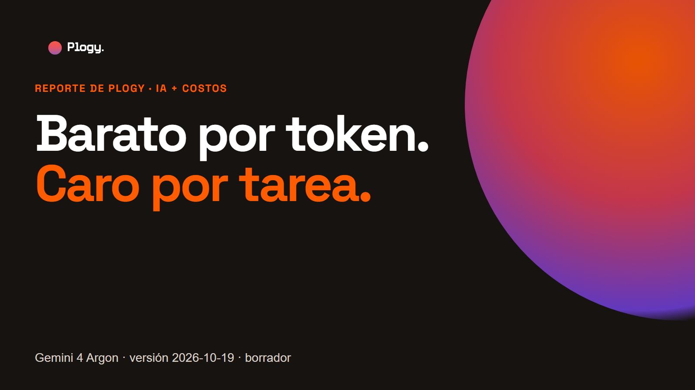
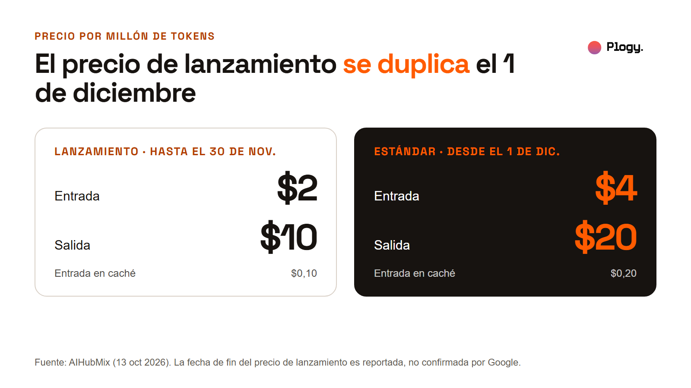
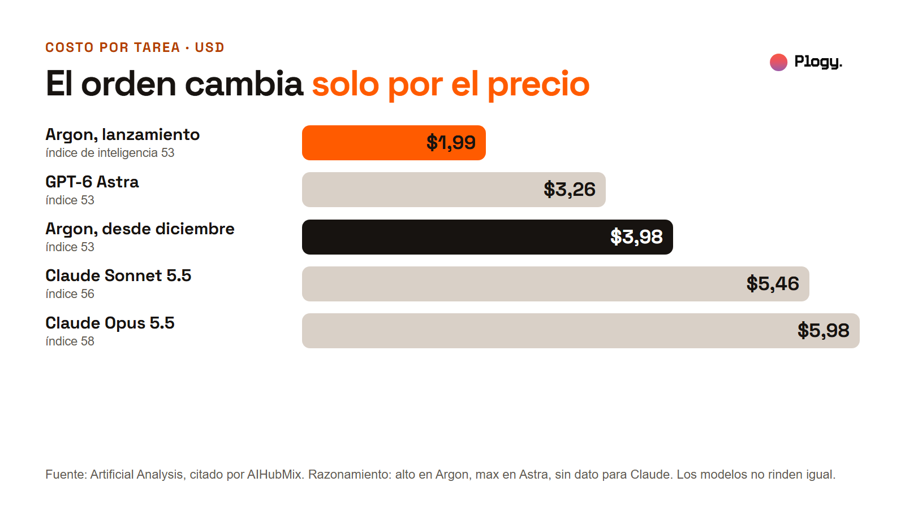
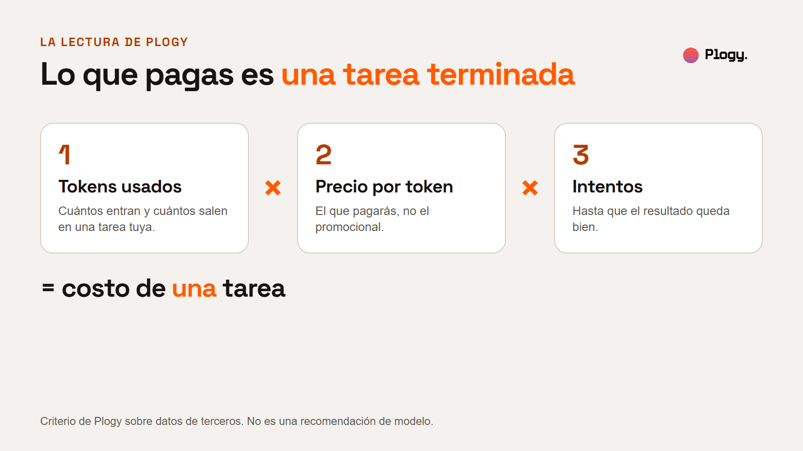
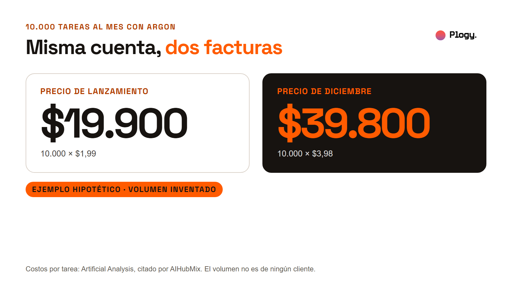

# Gemini 4 Argon: barato por token, pero no necesariamente por tarea

Reporte de Plogy · Pieza 003 · Palabra clave del carrusel: COSTO

- Estado: BORRADOR para revisión humana. No publicado.
- URL prevista: `/reportes/gemini-4-argon-costo-por-tarea` (por confirmar cuando se configure la web)
- Fecha de la versión: 2026-10-19
- Última actualización: 2026-10-19 (versión inicial)
- Pilar: Conocimiento · Audiencia: Negocios · Vertical: IA y automatizaciones
- Autor y revisor: pendiente de asignar

## Resumen

1. Google anunció Gemini 4 Argon el 30 de septiembre de 2026 con un precio de lanzamiento de $2 por millón de tokens de entrada y $10 de salida. Según lo reportado, ese precio se duplica el 1 de diciembre.
2. En pruebas de terceros, el modelo escribe mucho: unos 62.000 tokens de salida por tarea en un test de Artificial Analysis, 2,3 veces más que GPT-6 Astra. Por eso su costo por tarea no sigue el precio por token.
3. Para un negocio, la cifra que importa es el costo de una tarea terminada, calculado con el precio que se pagará y con los reintentos incluidos.

## 1. Qué pasó

Cada dato lleva su fuente. Todos vienen de terceros. Plogy no ha probado el modelo. Las figuras las elaboró Plogy con las cifras de las fuentes, y cada una dice de dónde sale.

### Anuncio y precio

- **Anuncio y fecha.** Gemini 4 Argon se lanzó el 30 de septiembre de 2026, según la página del modelo en Vals AI y varios medios. Una fuente reporta una ampliación de acceso a desarrolladores, empresas y suscriptores el 13 de octubre. Otra describe un acceso restringido. Ver la sección 2.
- **Precio.** Precio de lanzamiento: $2 de entrada, $10 de salida y $0,10 de entrada en caché, por millón de tokens. Precio estándar desde el 1 de diciembre de 2026: $4, $20 y $0,20. Batch y Flex cuestan la mitad del precio estándar. (AIHubMix, 13 de octubre de 2026.)

### Tokens y costo por tarea

- **Tokens por tarea.** En una tarea del test de Artificial Analysis, Argon escribió unos 62.000 tokens de salida, unas 2,3 veces los de GPT-6 Astra. (Artificial Analysis, citado por AIHubMix.)

.")

- **Costo por tarea.** En el mismo test, con el razonamiento que indica la fuente (alto en Argon, max en GPT-6 Astra, sin nivel indicado para los modelos de Claude):

| Modelo | Costo por tarea | Índice de inteligencia |
| --- | --- | --- |
| Gemini 4 Argon, precio de lanzamiento | $1,99 | 53 |
| GPT-6 Astra | $3,26 | 53 |
| Gemini 4 Argon, precio de diciembre | $3,98 | 53 |
| Claude Sonnet 5.5 | $5,46 | 56 |
| Claude Opus 5.5 | $5,98 | 58 |

  (Artificial Analysis, citado por AIHubMix. Los modelos no rinden igual: el índice de inteligencia no es el mismo en todos.)

### Otras pruebas

- **Otro test: Vals Index.** Gemini 4 Argon puntúa 68,90% con un costo de $15,68 por prueba al precio de $4/$20, y la actualización del 30 de septiembre de la página lo ubica primero entre 41 modelos. En otra parte de la misma página aparece tercero entre 22 con 69,24% y $13,37 por prueba. Claude Sonnet 5.5 puntúa 67,04% a $21,34 por prueba y Claude Opus 5.5 66,97% a $32,14. Las pruebas se hicieron con razonamiento alto. (Vals AI.)
- **Tareas largas de agentes.** Al mismo precio de $4/$20, Vals AI mide un costo por prueba de $193,78 en CUA-bench (donde Argon puntúa 4,83%), $57,82 en Code Migration, $44,90 en Terminal-Bench Science y $30,45 en SRE Bench. (Vals AI.)
- **Precio de lista de GPT-6 Astra.** $10 de entrada y $50 de salida por millón de tokens. (Engadget, citado por AIHubMix.)

## 2. Qué se sabe y qué no

**Reportado por fuentes que leímos:** los precios de lanzamiento y estándar, los resultados de Vals AI y los de Artificial Analysis tal como los cita AIHubMix.

**Lo que no sabemos o no pudimos verificar:**

- **Cuándo termina el precio de lanzamiento.** Una fuente da el 30 de noviembre. Otra indica que Google no habría publicado fecha de cierre. Tratamos el 1 de diciembre como fecha reportada, no confirmada.
- **Disponibilidad.** Una fuente habla de acceso restringido y otra de apertura general el 13 de octubre. No afirmamos ninguna.
- **Los números de Artificial Analysis.** Los vimos citados por AIHubMix, no en el sitio de Artificial Analysis. Hay que contrastarlos.
- **El puesto en el Vals Index.** La página de Vals AI da "#1 de 41" (68,90%, $15,68 por prueba) en su actualización del 30 de septiembre y "3 de 22" (69,24%, $13,37 por prueba) en otras partes. No reconcilia las dos cifras.
- **El costo con razonamiento medio o bajo.** Según AIHubMix, ningún evaluador lo había publicado. Las cifras anteriores usan el razonamiento que indica la fuente (alto en Argon, max en GPT-6 Astra), que gasta más que el medio.
- **El costo en las tareas de tu negocio.** Ningún test lo cubre.
- **Interés comercial.** AIHubMix ofrece acceso a modelos por API, incluido Argon. Es una fuente útil por sus cifras, y conviene leerla sabiendo eso.

## 3. La lectura de Plogy

Un precio por token es una tarifa, no un presupuesto. Lo que se paga es una tarea terminada:

> costo de una tarea = tokens usados × precio por token × intentos hasta que queda bien

Un modelo con una tarifa baja puede salir caro si escribe mucho, y el precio del lanzamiento puede no ser el que pagarás. En el test de Artificial Analysis, Argon tiene el costo por tarea más bajo de los cinco modelos de la tabla con el precio de lanzamiento, y queda por encima de GPT-6 Astra con el precio de diciembre. El orden cambia solo por el precio: los tokens por tarea son los mismos, y lo que se duplica es la tarifa. (La fuente incluye además un modelo más barato, Gemini 3.1 Pro Preview, con un índice de inteligencia de 30. No está en la tabla porque su índice de inteligencia es mucho menor.)

Esta es una lectura de Plogy sobre datos de terceros. No es una recomendación de modelo.

## 4. Qué significa para tu negocio

Tres cuentas antes de elegir un modelo:

1. **Mide los tokens de una tarea real.** No los de un benchmark ajeno. Cuántos tokens entran y cuántos salen en una tarea tuya.
2. **Usa el precio que pagarás.** Si hay un precio promocional con fecha de fin, calcula con el precio estándar.
3. **Suma los reintentos.** Cada vez que una respuesta no sirve y hay que repetirla, la tarea cuesta otra vez.

**Ejemplo hipotético, con un volumen inventado.** Si un proceso hiciera 10.000 tareas al mes con el costo por tarea que Artificial Analysis midió para Argon, serían 10.000 × $1,99 = $19.900 con el precio de lanzamiento, y 10.000 × $3,98 = $39.800 con el de diciembre. El volumen es inventado para mostrar la cuenta. No es un caso de un cliente.

**El costo no es la única variable.** El índice de inteligencia de esos modelos no es el mismo (53, 53, 56 y 58 en el test citado). Un costo por tarea menor solo es una ventaja si el modelo resuelve la tarea igual de bien. Eso se comprueba con tareas propias.

## 5. Qué haría Plogy primero

Es criterio de Plogy, no un hecho de las fuentes, y todavía no lo hemos aplicado con este modelo.

1. Elegir una tarea real del negocio y definir cuándo está bien hecha.
2. Medir una muestra de esas tareas con cada modelo candidato: tokens de entrada y de salida, intentos y si el resultado sirvió.
3. Calcular el costo con el precio estándar y no con el de lanzamiento.
4. Revisar si algunos pasos simples pueden ir a un modelo más barato, y dejar el modelo caro para los pasos difíciles.

**Recomendaciones del autor de AIHubMix** (no son de Plogy): presupuestar con el precio de diciembre, empezar con razonamiento medio, usar Batch o Flex cuando se pueda, enrutar los pasos simples a un modelo más barato y evitar reintentar respuestas rechazadas.

## 6. Fuentes

Leídas completas el 2026-10-19:

- AIHubMix, "Gemini 4 Argon pricing: cheap per token, not per task", 13 de octubre de 2026. https://aihubmix.com/blog/gemini-4-argon-pricing-cheap-per-token-not-per-task
- Vals AI, página del modelo Gemini 4 Argon. https://www.vals.ai/models/google_gemini-4-argon

Vistas en los resultados de búsqueda, no leídas completas (para contrastar):

- eesel.ai, "Gemini 4 Argon pricing: the $2/$10 promo, the $4/$20 bill, and what a task really costs". https://www.eesel.ai/blog/gemini-4-argon-pricing
- SmartScope, sobre acceso y precio de lanzamiento. https://smartscope.blog/en/blog/gemini-4-argon-access-introductory-pricing-2026/
- AI Weekly, alerta sobre la apertura del modelo con precio de entrada de $2/$10. https://aiweekly.co/fr/alerts/google-ouvre-gemini-4-argon-mondialement-un-prix-dappel-210

Pendientes de consultar: el anuncio original de Google y el sitio de Artificial Analysis.

## 7. Siguiente paso

Sigue a Plogy para ver cómo se implementa la IA en negocios, con las cuentas hechas.

## Historial de cambios

- 2026-10-19: versión inicial en borrador.
- 2026-10-19: añadidas 6 figuras (portada, precios, tokens, costo por tarea, fórmula, ejemplo) y una foto de la biblioteca. Las figuras se generan desde `reporte-figuras.html`.
- 2026-10-20: tras la revisión editorial independiente, se corrigió el nivel de razonamiento (alto en Argon, max en Astra, sin dato para Claude) y el puesto en el Vals Index (la página dice hoy 41 y 22 modelos, no 50).
