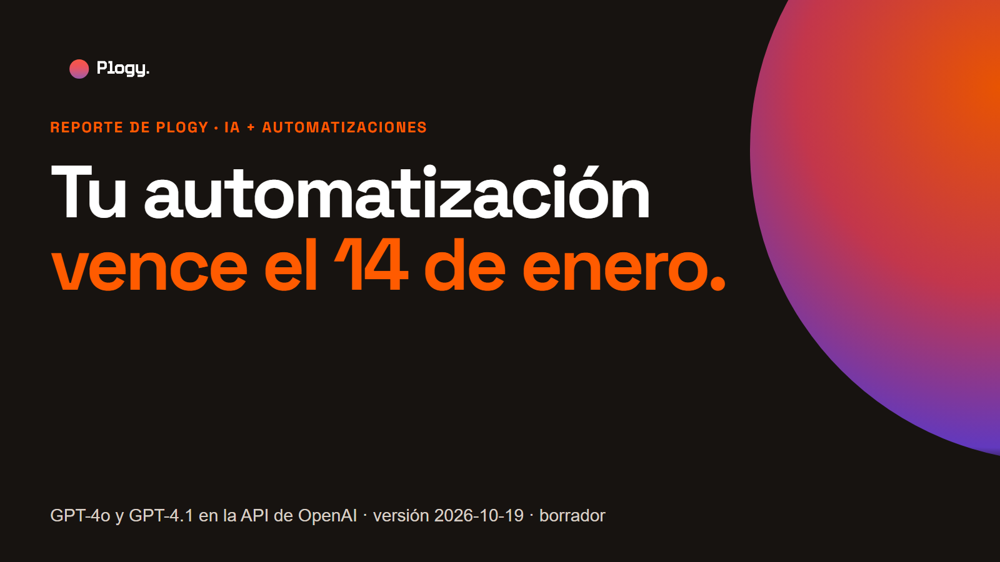
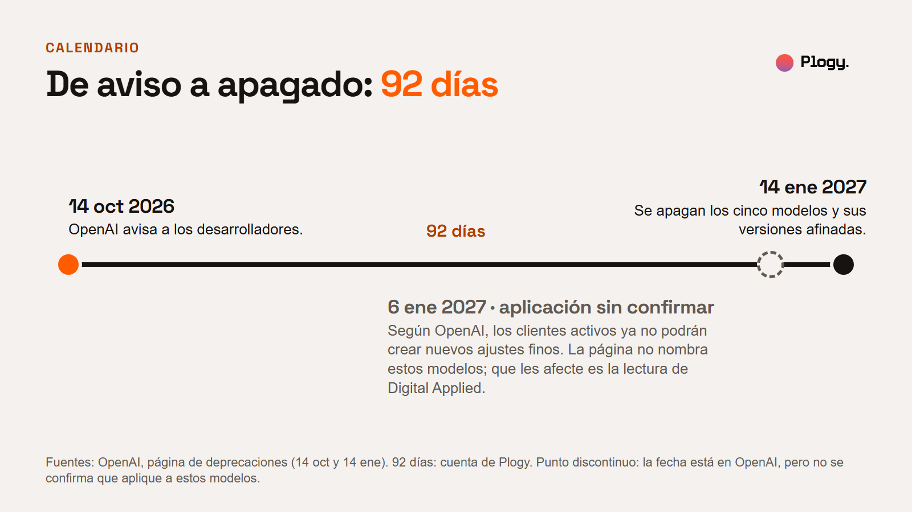
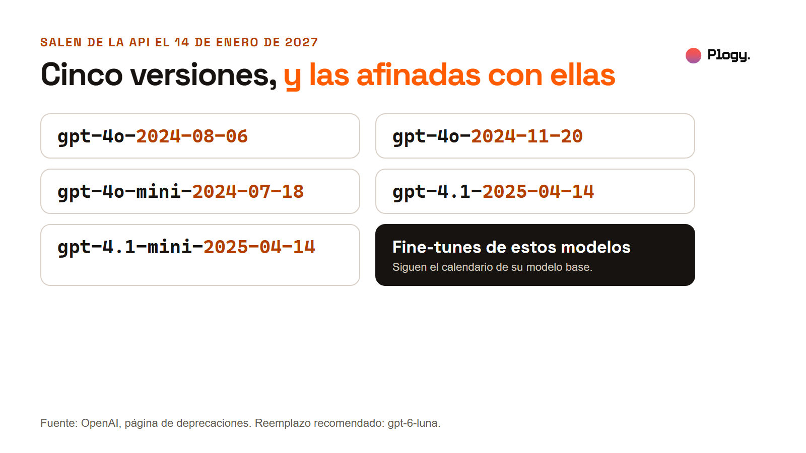
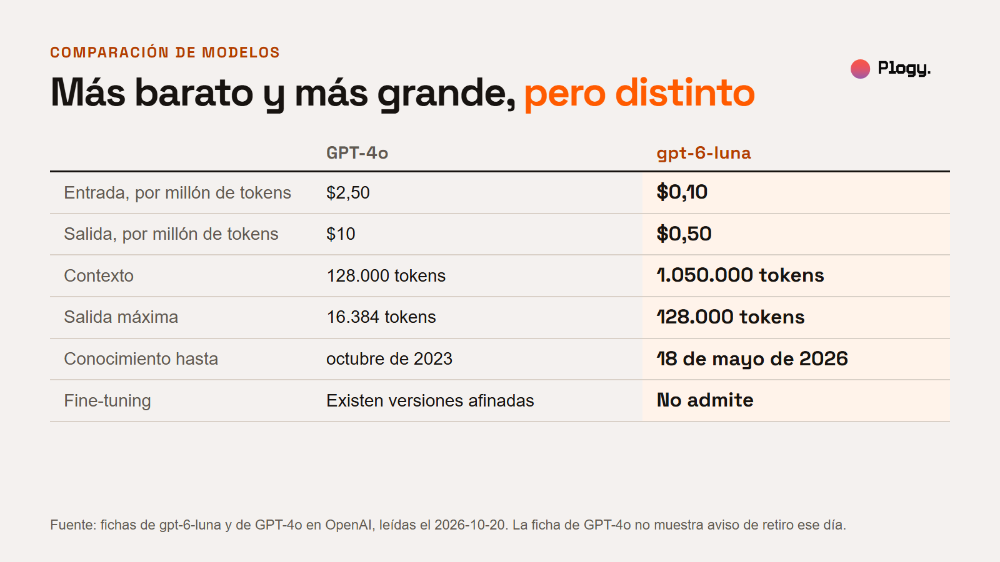
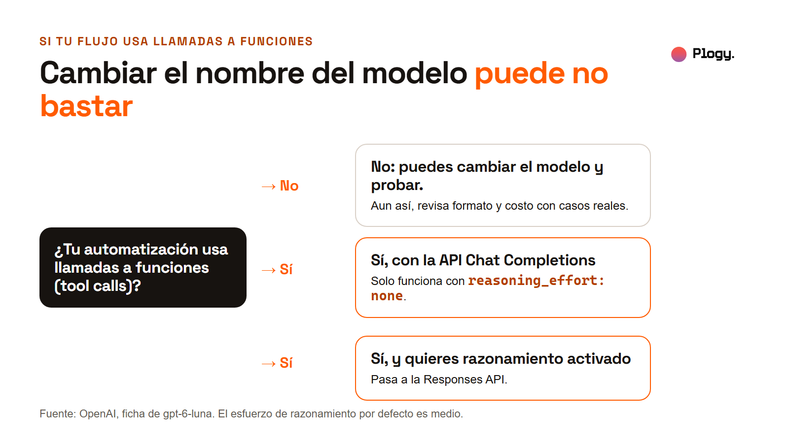
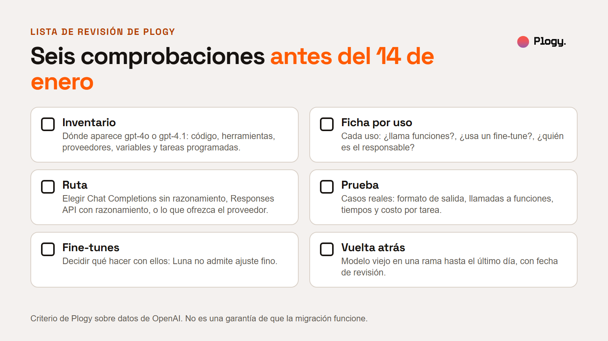

# GPT-4o y GPT-4.1 se apagan el 14 de enero: qué revisar para no romper tu automatización

Reporte de Plogy · Pieza 004 · Palabra clave del carrusel: MIGRAR

- Estado: BORRADOR para revisión humana. No publicado.
- URL prevista: `/reportes/gpt-4o-gpt-4-1-se-apagan-14-enero` (por confirmar cuando se configure la web)
- Fecha de la versión: 2026-10-19
- Última actualización: 2026-10-19 (versión inicial)
- Pilar: Conocimiento · Audiencia: Negocios · Vertical: IA y automatizaciones
- Autor y revisor: pendiente de asignar

## Resumen

1. OpenAI avisó el 14 de octubre de 2026 de que cinco versiones de GPT-4o y GPT-4.1 salen de su API el 14 de enero de 2027. Las versiones afinadas (fine-tunes) de esos modelos siguen el mismo calendario. El reemplazo que recomienda es `gpt-6-luna`.
2. El reemplazo no es un cambio de nombre. Según la ficha de OpenAI, `gpt-6-luna` razona por defecto, solo admite llamadas a funciones en Chat Completions con el razonamiento apagado y no admite fine-tuning.
3. Para un negocio, el riesgo es una automatización que deje de funcionar sin que nadie lo note. Lo primero es saber en qué lugares aparece el nombre del modelo. Al final hay una lista de revisión de seis comprobaciones.

## 1. Qué pasó

Cada dato lleva su fuente. Las fechas, los identificadores y los datos de `gpt-6-luna`, GPT-4o y los otros modelos que se apagan vienen de páginas de OpenAI que leímos. Algunas lecturas vienen de terceros y se rotulan. Plogy no ha migrado ningún flujo con este modelo.

### Calendario

- **Aviso.** El 14 de octubre de 2026 OpenAI notificó a los desarrolladores que usan ciertos modelos de la serie GPT-4 que se eliminarán de la API el 14 de enero de 2027. (OpenAI, página de deprecaciones.)
- **Plazo.** Del aviso al apagado pasan 92 días. La página de OpenAI declara al menos seis meses de aviso para modelos de disponibilidad general, salvo razones de seguridad o cumplimiento, y no dice si estos modelos lo son. Mixed señala la diferencia. Nada de lo que leímos la explica.

### Qué se apaga

Todos salen de la API el 14 de enero de 2027, con `gpt-6-luna` como reemplazo recomendado. (OpenAI, página de deprecaciones.)

- `gpt-4o-2024-08-06` y `gpt-4o-2024-11-20`
- `gpt-4o-mini-2024-07-18`
- `gpt-4.1-2025-04-14`
- `gpt-4.1-mini-2025-04-14`

OpenAI dice que las versiones afinadas de estos modelos "siguen el mismo calendario de apagado que sus modelos base". La cita es una traducción nuestra de la frase original en inglés.

### Reemplazo y precio

La ficha de `gpt-6-luna` en OpenAI indica un precio de $0,10 de entrada, $0,01 de entrada en caché y $0,50 de salida por millón de tokens, un contexto de 1.050.000 tokens, una salida máxima de 128.000 tokens y conocimiento hasta el 18 de mayo de 2026. Admite salidas estructuradas y llamadas a funciones. No admite fine-tuning. Los precios cambian por encima de 272.000 tokens de entrada, con modo Batch o Flex y con procesamiento regional.

Las fichas de OpenAI de GPT-4o dan $2,50 de entrada y $10 de salida, un contexto de 128.000 tokens, una salida máxima de 16.384 tokens y conocimiento hasta el 1 de octubre de 2023. La ficha de GPT-4o no muestra aviso de retiro el 2026-10-20, aunque la página de deprecaciones sí lo anuncia.

La rebaja por token depende del modelo que se apaga. Cuenta de Plogy sobre las fichas de OpenAI:

| Modelo que se apaga | Entrada | Salida | Luna es menos en entrada | Luna es menos en salida |
| --- | --- | --- | --- | --- |
| GPT-4o | $2,50 | $10 | 25 veces | 20 veces |
| GPT-4.1 | $2 | $8 | 20 veces | 16 veces |
| GPT-4.1 mini | $0,40 | $1,60 | 4 veces | 3,2 veces |
| GPT-4o mini | $0,15 | $0,60 | 1,5 veces | 1,2 veces |

Luna cuesta $0,10 de entrada y $0,50 de salida. Es una comparación de tarifa por token. Lo que cuesta una tarea no está en ninguna de estas páginas.

## 2. Qué se sabe y qué no

**Confirmado en páginas de OpenAI que leímos:** el aviso del 14 de octubre, los cinco identificadores, la fecha del 14 de enero de 2027, el calendario de los fine-tunes, el reemplazo recomendado, los datos de `gpt-6-luna` (precio, contexto, llamadas a funciones, razonamiento, fine-tuning) y los precios y límites de GPT-4o, GPT-4o mini, GPT-4.1 y GPT-4.1 mini. También que el razonamiento se factura como tokens de salida y que `gpt-6-luna` usa esfuerzo medio por defecto.

**Reportado por terceros, sin confirmar en OpenAI:**

- **Que el 6 de enero de 2027 sea el fin de los fine-tunes nuevos de estos modelos.** La página de OpenAI trae esa fecha como cierre general del ajuste fino de autoservicio para clientes activos, sin nombrar modelos. Que les afecte es la lectura de Digital Applied.
- **Qué pasa con los alias.** Digital Applied indica que los nombres sin fecha apuntan a estas versiones, y que la página de OpenAI no dice qué hacen después del apagado. No afirmamos nada sobre alias.

**Lo que no sabemos:**

- **Si tu automatización funcionará igual con `gpt-6-luna`.** Eso depende de tu caso y solo se sabe probando.
- **El costo por tarea con el modelo nuevo.** El precio por token es bajo, pero el razonamiento por defecto consume tokens de salida.
- **Por qué el plazo es de 92 días, y si estos modelos son de disponibilidad general.** OpenAI no lo explica en lo que leímos.
- **Interés comercial de las fuentes.** Digital Applied vende servicios de migración de API y termina sus artículos con ofertas propias. Sus recomendaciones se leen sabiendo eso. Mixed es una publicación de noticias sin oferta comercial evidente en lo que leímos.

## 3. La lectura de Plogy

Un modelo es una dependencia de tu automatización, como lo es una API, un certificado o una versión de un programa. Las dependencias tienen fecha de vencimiento, y quien no sabe dónde están no puede renovarlas a tiempo.

Ya pasa con los precios: la tarifa por token no es lo que paga un negocio. Aquí el mismo principio aparece de otra forma. El cambio de modelo mueve el precio, pero también el formato de la salida, las llamadas a funciones y el razonamiento. Cada uno puede romper un flujo que hoy funciona.

Esta es una lectura de Plogy sobre datos de OpenAI. No es una recomendación de modelo.

## 4. Qué significa para tu negocio

**Si tu flujo usa llamadas a funciones, cambiar el nombre puede no bastar.** En Chat Completions, `gpt-6-luna` solo admite llamadas a funciones con `reasoning_effort` en `none`. Con razonamiento activado, OpenAI indica usar la Responses API. Eso puede significar tocar código, o pedirle a quien te vendió la automatización que lo haga.

**Si tienes un fine-tune, no tiene camino directo.** Según la ficha, `gpt-6-luna` no admite fine-tuning, y el fine-tune del modelo viejo sigue el calendario de su modelo base. Habría que decidir si se reemplaza por instrucciones y ejemplos en el prompt u otra vía. Esa decisión se toma con pruebas.

**Si dependes de un proveedor, pregúntale.** Una herramienta que compraste puede llamar a GPT-4o por dentro sin que lo veas. La pregunta es qué modelo usa y qué fecha tiene su plan de cambio.

**Si miras el costo, mide la tarea.** El precio por token baja mucho. Como el razonamiento se factura como tokens de salida, una tarea puede usar más tokens que antes.

**Ejemplo hipotético, sin ningún caso real.** Una pyme imaginaria tiene un flujo de atención al cliente que llama a `gpt-4o-mini-2024-07-18` por Chat Completions y usa llamadas a funciones para consultar pedidos. Al migrar, tiene dos caminos: dejar el razonamiento en `none` y conservar el código casi igual, o pasar a la Responses API con razonamiento. En los dos casos hay que probar con conversaciones reales antes del 14 de enero. Es un caso inventado para mostrar la decisión.

## 5. Qué haría Plogy primero

Es criterio de Plogy, no un hecho de las fuentes, y todavía no lo hemos aplicado a una migración a `gpt-6-luna`. Esta es la lista de revisión:

- [ ] **Inventario.** Buscar dónde aparece gpt-4o o gpt-4.1: código, herramientas sin código, proveedores, variables de entorno y tareas programadas.
- [ ] **Ficha por uso.** Para cada uso, anotar si llama funciones, si usa un fine-tune y quién es la persona responsable.
- [ ] **Ruta.** Elegir entre Chat Completions sin razonamiento, la Responses API con razonamiento, o el reemplazo que ofrezca el proveedor.
- [ ] **Prueba.** Correr casos reales y comparar formato de salida, llamadas a funciones, tiempos y costo por tarea.
- [ ] **Fine-tunes.** Decidir qué se hace con cada uno, porque `gpt-6-luna` no admite ajuste fino.
- [ ] **Vuelta atrás.** Dejar el modelo viejo en una rama hasta el último día y poner una fecha de revisión.

**Recomendaciones de Digital Applied** (no son de Plogy): usar el campo `shutdown_date` del endpoint de modelos para auditar retiros, probar alrededor de 50 prompts registrados, cambiar las alertas de costo a dólares, no contar con prórroga y revisar otros retiros del mismo calendario (diciembre de 2026 a abril de 2027).

## 6. Fuentes

Leídas completas el 2026-10-19:

- OpenAI, "Deprecations", entrada "GPT-4 series model deprecations" del 14 de octubre de 2026. https://developers.openai.com/api/docs/deprecations
- OpenAI, ficha del modelo `gpt-6-luna`. https://developers.openai.com/api/docs/models/gpt-6-luna
- OpenAI, guía de razonamiento (facturación como tokens de salida y esfuerzo por defecto). https://developers.openai.com/api/docs/guides/reasoning
- Mixed, "OpenAI's own page still calls GPT-4o its flagship, and it leaves the API on January 14". https://mixed-news.com/en/openai-gpt-4o-gpt-4-1-shutdown-january-14-2027-92-days-notice/
- Digital Applied, "GPT-4o and GPT-4.1 Leave OpenAI's API on January 14, 2027". https://www.digitalapplied.com/blog/gpt-4o-gpt-4-1-api-shutdown-january-2027

Vistas en los resultados de búsqueda, no leídas completas:

- FourWeekMBA, "OpenAI Retires GPT-4o and GPT-4.1, Points to $0.10 Luna". La lectura devolvió HTTP 403. https://fourweekmba.com/ai-openai-retires-gpt-4o-and-gpt-41-points-to-010-luna/
- Daily.dev, sobre el aviso de tres meses. https://daily.dev/posts/openai-promised-developers-six-months-notice-gpt-4o-users-got-three--srbz67kxw

Leídas el 2026-10-20 para contrastar: las fichas de OpenAI de GPT-4o, GPT-4o mini, GPT-4.1 y GPT-4.1 mini (precios y límites).

## 7. Siguiente paso

Sigue a Plogy para ver cómo se implementa la IA en negocios, con las dependencias controladas.

## Historial de cambios

- 2026-10-19: versión inicial en borrador, con portada, cinco figuras, una foto de la biblioteca y la lista de revisión. Las figuras se generan desde `reporte-figuras.html`.
- 2026-10-20: tras la revisión editorial independiente, se verificaron los datos de GPT-4o y de los otros tres modelos en OpenAI, se acotó el "25 veces" a GPT-4o (con la tabla por modelo), se corrigió la nota del 6 de enero y la atribución de la política de seis meses.
