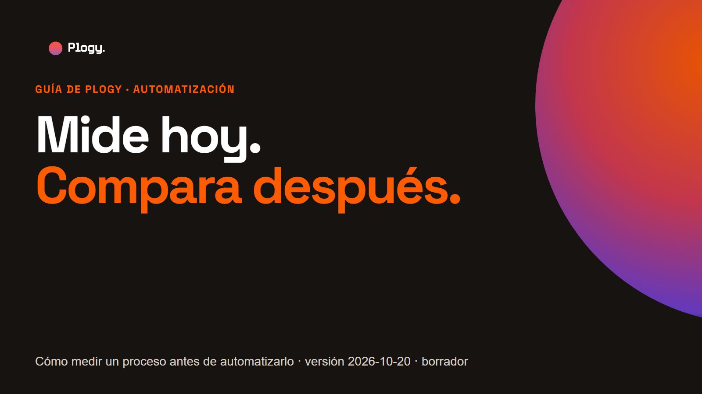
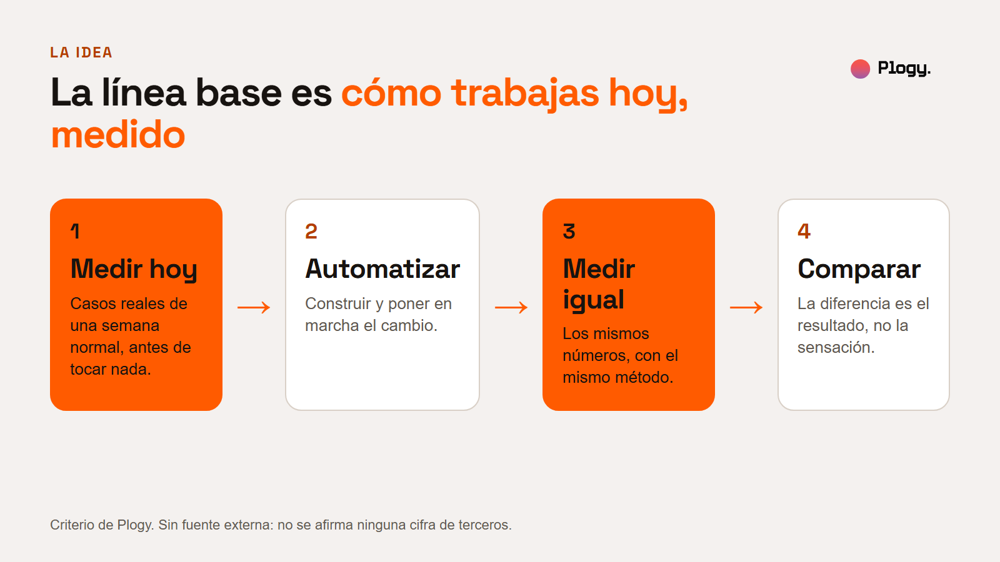
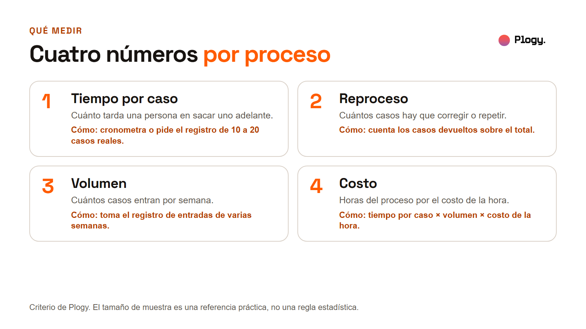
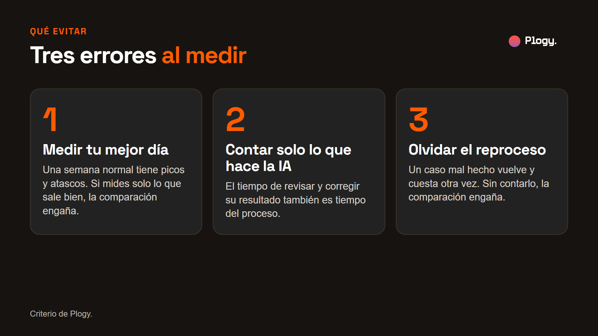
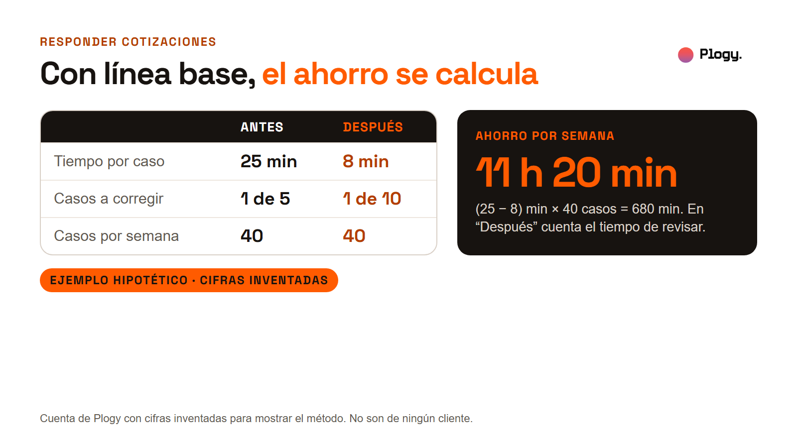
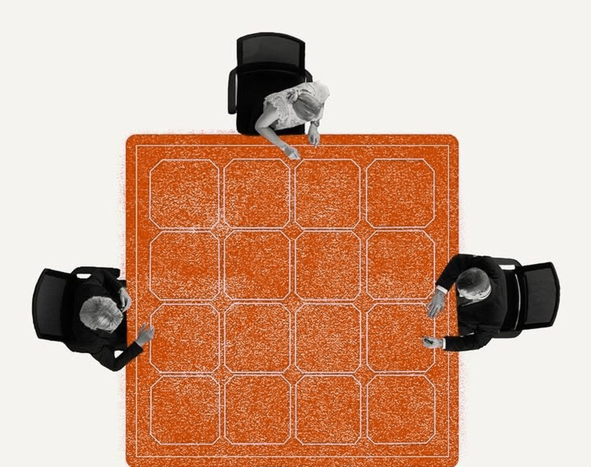
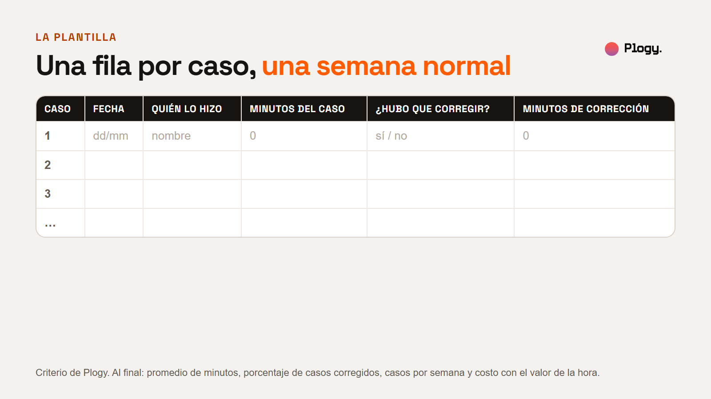

# Mide hoy, compara después: guía para medir un proceso antes de automatizarlo

Guía de Plogy · Pieza 005 · Palabra clave del carrusel: MEDIR

- Estado: BORRADOR para revisión humana. No publicado.
- URL prevista: `/guias/medir-antes-de-automatizar` (por confirmar cuando se configure la web)
- Fecha de la versión: 2026-10-20
- Última actualización: 2026-10-20 (versión inicial)
- Pilar: Conocimiento · Audiencia: Negocios · Vertical: IA y automatizaciones
- Tipo: guía educativa. No parte de una noticia.
- Autor y revisor: pendiente de asignar

## Resumen

1. Una automatización se puede juzgar solo si antes se midió cómo se hacía el trabajo. Esa medición es la línea base.
2. Bastan cuatro números por proceso: tiempo por caso, reproceso, volumen y costo.
3. Hay tres errores comunes al medir: tomar el mejor día, contar solo lo que hace la IA y olvidar el reproceso.
4. Al final hay una plantilla de una fila por caso para empezar hoy.

## 1. La idea

La línea base es cómo trabajas hoy, medido. Se toma antes de cambiar nada, con casos reales de una semana normal. Cuando el proceso ya está automatizado se vuelve a medir con el mismo método, y la diferencia entre las dos mediciones es el resultado.

Sin ese punto de partida solo quedan frases como "se siente más rápido" o "parece que hay menos errores". Son opiniones y no sirven para decidir si seguir invirtiendo, ajustar el flujo o dejarlo.

Esta guía es criterio de Plogy. No cita estudios ni cifras de terceros, y las cifras del ejemplo son inventadas y están rotuladas.

## 2. Qué medir

Cuatro números alcanzan para casi cualquier proceso repetitivo:

1. **Tiempo por caso.** Cuánto tarda una persona en sacar uno adelante. Se cronometra o se saca de un registro, con una muestra de casos reales. Incluye el tiempo de revisar y, si hubo que corregir, los minutos de corrección: la plantilla los separa en dos columnas y se suman. Como referencia práctica, de 10 a 20 casos; no es una regla estadística.
2. **Reproceso.** Cuántos casos hay que corregir o repetir. Se cuentan los casos devueltos sobre el total.
3. **Volumen.** Cuántos casos entran por semana. Se toma del registro de entradas de varias semanas, no de una sola.
4. **Costo.** Tiempo por caso × volumen × costo de la hora. Es una cuenta sencilla de lo que cuesta hoy el proceso en tiempo de personas.

## 3. Cómo medirlo, paso a paso

1. **Elige un proceso.** Uno repetitivo, con un caso que empieza y termina claramente (una cotización, una factura, una respuesta).
2. **Define cuándo un caso está bien hecho.** Sin esa definición no se puede contar el reproceso.
3. **Toma casos reales de una semana normal.** Si hay picos de trabajo en el mes, incluye una semana de pico por separado.
4. **Anota por cada caso:** quién lo hizo, cuántos minutos tardó, si hubo que corregirlo y cuántos minutos costó la corrección.
5. **Calcula** el promedio de minutos, el porcentaje de casos corregidos, el volumen por semana y el costo con el valor de la hora.
6. **Guarda el método.** Cuando midas de nuevo, hazlo igual, con la misma definición y el mismo tipo de semana.

## 4. Tres errores al medir

- **Medir tu mejor día.** Una semana normal tiene picos y atascos. Si solo mides lo que sale bien, la comparación engaña.
- **Contar solo lo que hace la IA.** El tiempo de revisar y corregir su resultado también es tiempo del proceso. Si no se suma, el ahorro se ve mayor de lo que es.
- **Olvidar el reproceso.** Un caso mal hecho vuelve y cuesta otra vez.

## 5. Un ejemplo, con cifras inventadas

**Ejemplo hipotético. Ninguna cifra es de un cliente ni de una fuente.** Imagina un negocio que responde cotizaciones. En la línea base mide 25 minutos por cotización, 1 de cada 5 con correcciones y 40 cotizaciones por semana. Después de automatizar y medir igual, mide 8 minutos por cotización (incluyendo la revisión), 1 de cada 10 con correcciones y las mismas 40 por semana.

La cuenta: (25 − 8) × 40 = 680 minutos, es decir, 11 horas y 20 minutos por semana. Además, el reproceso baja de 8 casos por semana (1 de 5 sobre 40) a 4 (1 de 10 sobre 40). Con la línea base el ahorro se puede explicar y defender. Sin ella solo se podría decir que "se siente más rápido".

Lo que el ejemplo no dice: si ese ahorro compensa el costo de la automatización. Eso requiere sumar lo que costó construirla y mantenerla.

## 6. La plantilla

Una fila por caso. Cópiala a una hoja de cálculo:

| Caso | Fecha | Quién lo hizo | Minutos del caso | ¿Hubo que corregir? | Minutos de corrección |
| --- | --- | --- | --- | --- | --- |
| 1 | dd/mm | nombre | 0 | sí / no | 0 |
| 2 | | | | | |
| 3 | | | | | |

Al final de la semana:

- [ ] Promedio de minutos por caso (columna Minutos, más la de corrección).
- [ ] Porcentaje de casos que hubo que corregir.
- [ ] Casos por semana.
- [ ] Costo semanal: minutos totales ÷ 60 × costo de la hora.
- [ ] Anotar qué tipo de semana fue (normal, de pico) y cómo se definió "bien hecho".

## 7. Qué haría Plogy primero

Es criterio de Plogy, no un hecho de fuentes externas. Antes de proponer cualquier automatización, mediría un solo proceso con esta plantilla y dejaría la medición escrita. Después propondría el cambio, y volvería a medir igual. Esta guía todavía no se ha aplicado a un cliente de Plogy.

## 8. Lo que esta guía no cubre

- **El tamaño de muestra estadístico.** Los 10 a 20 casos son una referencia práctica.
- **Beneficios que no son tiempo ni costo,** como calidad de atención o menos errores graves. Se pueden medir, pero requieren definir cómo.
- **El costo de construir y mantener la automatización.** Se resta aparte del ahorro.
- **Procesos con muy pocos casos al mes.** Ahí conviene medir por periodos más largos.

## 9. Fuentes

No hay fuentes externas. El contenido es criterio de Plogy, con un ejemplo de cifras inventadas rotulado como hipotético. Una revisión humana puede añadir referencias de mejora de procesos si lo considera útil. Pendiente.

## 10. Siguiente paso

Sigue a Plogy para ver cómo se implementa la IA en negocios, midiendo antes y después.

## Historial de cambios

- 2026-10-20: versión inicial en borrador, con portada, cinco figuras, una foto de la biblioteca y la plantilla. Las figuras se generan desde `reporte-figuras.html`.
- 2026-10-20: tras la revisión editorial independiente, se corrigió la frase del error 3 en la figura (olvidar el reproceso distorsiona la comparación, no necesariamente infla el ahorro) y se aclaró qué minutos incluye el tiempo por caso.
