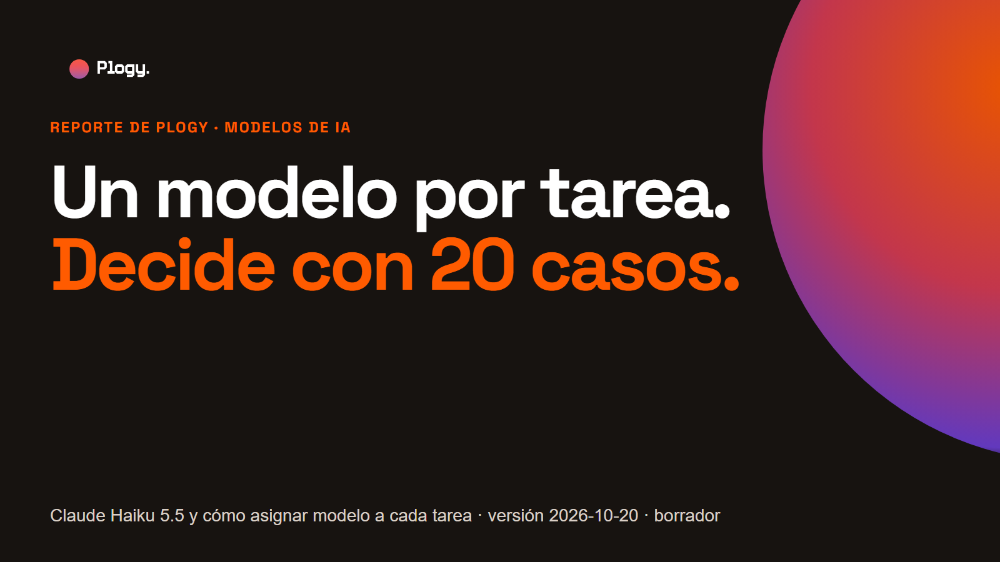
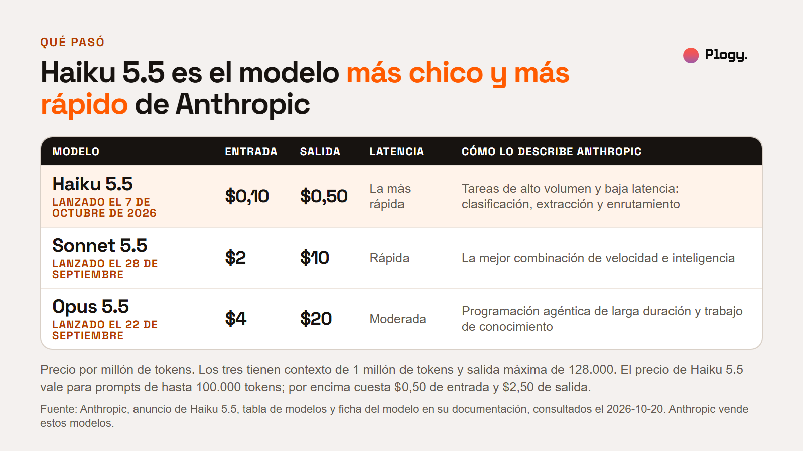
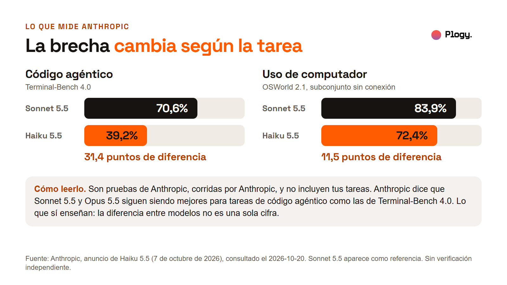
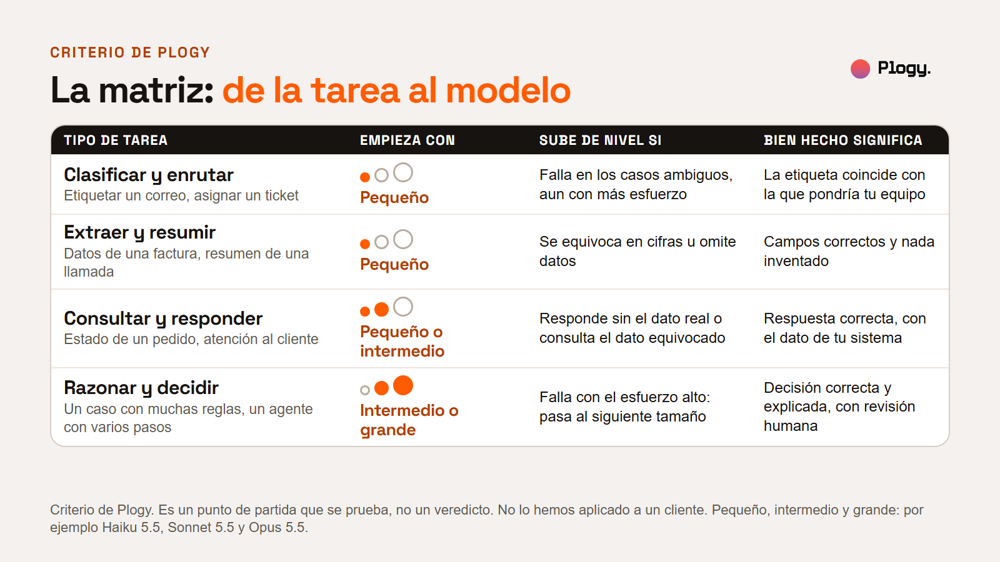
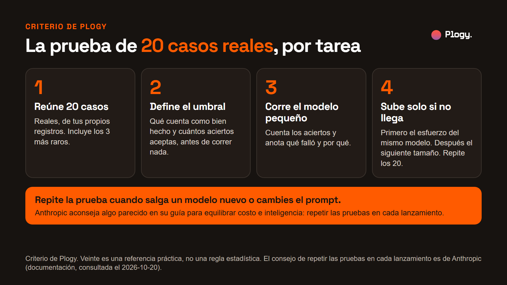
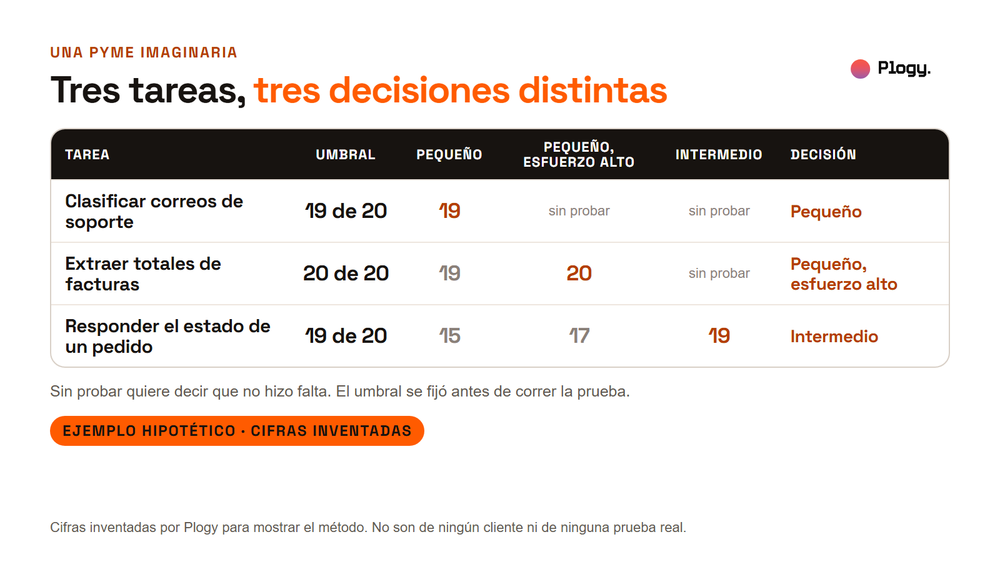
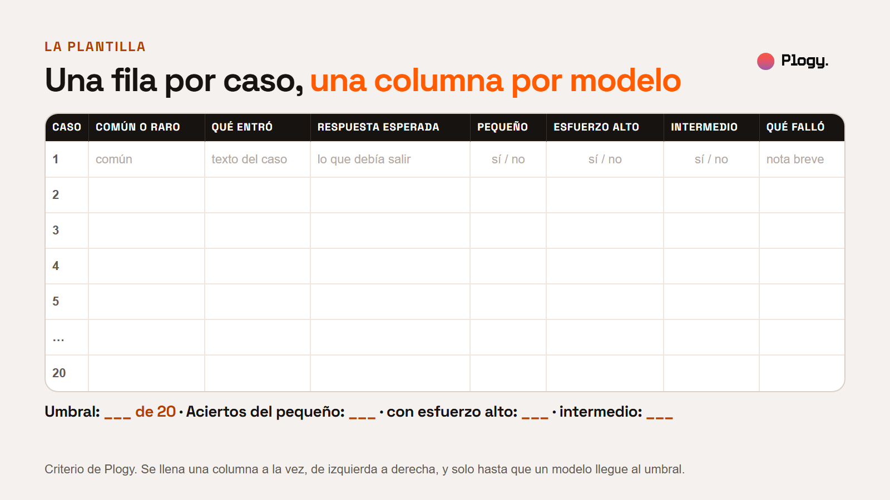

# Claude Haiku 5.5 y la matriz de tarea a modelo: cómo elegir con 20 casos reales

Reporte de Plogy · Pieza 006 · Palabra clave del carrusel: ELEGIR

- Estado: BORRADOR para revisión humana. No publicado.
- URL prevista: `/reportes/haiku-5-5-modelo-por-tarea` (por confirmar cuando se configure la web)
- Fecha de la versión: 2026-10-20
- Última actualización: 2026-10-20 (versión inicial)
- Pilar: Conocimiento · Audiencia: Negocios · Vertical: IA y automatizaciones
- Autor y revisor: pendiente de asignar

## Resumen

1. Anthropic lanzó Claude Haiku 5.5 el 7 de octubre de 2026. Lo describe como su modelo pequeño más rápido y más capaz, hecho para tareas repetidas y de alto volumen como resumir, clasificar, consultar bases de datos y atender en vivo.
2. Las propias pruebas de Anthropic muestran que la distancia con Sonnet 5.5 cambia según la tarea: 31,4 puntos en una prueba de código agéntico y 11,5 en una de uso de computador. Ninguna incluye tus tareas.
3. Un negocio no tiene una tarea, tiene muchas. El criterio de Plogy es clasificarlas por tipo, asignar a cada tipo un modelo de partida y decidir con una prueba de 20 casos reales por tarea.
4. Al final hay una matriz, un ejemplo hipotético y una plantilla para correr la prueba hoy.

## 1. Qué pasó

Los datos de esta sección vienen de páginas de Anthropic que leímos el 2026-10-20 (ver Fuentes). Anthropic fabrica y vende los modelos que compara, y las cifras de comparación son suyas. Lo que viene de terceros se rotula. Plogy no ha probado Haiku 5.5 en ningún flujo de un cliente.

### El lanzamiento

- **Fecha.** El 7 de octubre de 2026 Anthropic publicó "Introducing Claude Haiku 5.5". El anuncio lo llama "el modelo pequeño más barato, más rápido y más capaz que hemos lanzado" (traducción nuestra de la frase en inglés).
- **Identificador.** `claude-haiku-5-5`. Está en la API de Claude y en Amazon Bedrock, Google Cloud, Microsoft Foundry y Claude Platform on AWS.
- **Retiro.** Anthropic compromete mantenerlo al menos hasta el 7 de octubre de 2027, para las plataformas que opera.

### Ficha y precio

- **Precio de Haiku 5.5.** $0,10 de entrada y $0,50 de salida por millón de tokens para prompts de hasta 100.000 tokens. Por encima de 100.000, $0,50 de entrada y $2,50 de salida. La API por lotes (Batch) tiene 50% de descuento.
- **Contexto y salida.** 1 millón de tokens de contexto y hasta 128.000 de salida. La ficha de Anthropic da los mismos valores para Sonnet 5.5 y Opus 5.5.
- **Los otros dos tamaños.** Sonnet 5.5 cuesta $2 de entrada y $10 de salida. Opus 5.5 cuesta $4 y $20. Hay además un modelo por encima de Opus, Fable 5.1, a $10 y $50, que esta guía no usa.
- **Lo que dice Anthropic de su precio.** Que cuesta 90% menos que Haiku 4.5 en solicitudes de hasta 100.000 tokens y 50% menos por encima, y que usa algo más de tokens por tarea por un tokenizador nuevo. En su documentación, el mismo texto cuenta aproximadamente 30% más tokens que en Haiku 4.5.

### Para qué lo propone Anthropic

Según el anuncio, Haiku 5.5 está pensado para "tareas de alto volumen y sensibles al costo": trabajo rápido y repetitivo como resúmenes, compactación de contexto, consultas a bases de datos y clasificación. También para tareas donde importa la velocidad, como atención al cliente en vivo y uso de navegador, y como subagente junto a Opus 5.5 y Sonnet 5.5 en trabajo de código. La documentación lo resume como un modelo para "tareas de alto volumen y baja latencia como clasificación, extracción y enrutamiento".

Anthropic también dice dónde no: que Haiku 5.5 rinde mejor en tareas de alcance acotado y que Sonnet 5.5 y Opus 5.5 siguen siendo mejores para tareas de código agéntico complejo como las que mide Terminal-Bench 4.0.

### La brecha según la tarea

En el anuncio, Anthropic publica una tabla con varias pruebas. Tomamos dos para ver el punto:

| Prueba (categoría) | Haiku 5.5 | Sonnet 5.5 | Diferencia |
| --- | --- | --- | --- |
| Terminal-Bench 4.0 (código agéntico) | 39,2% | 70,6% | 31,4 puntos |
| OSWorld 2.1, subconjunto sin conexión (uso de computador) | 72,4% | 83,9% | 11,5 puntos |

La diferencia son cuentas de Plogy sobre la tabla de Anthropic. Sonnet 5.5 aparece en la tabla como referencia. El método de las pruebas está en la tarjeta del sistema de Haiku 5.5, que no leímos.

## 2. Qué se sabe y qué no

**Confirmado en páginas de Anthropic que leímos:** la fecha de lanzamiento, el identificador, los precios de los tres modelos (en el anuncio, en la tabla de modelos de la documentación y en la página de precios de claude.com), el contexto de 1 millón de tokens y la salida de 128.000, el descuento de 50% por lotes, los usos que Anthropic propone, su advertencia sobre código agéntico complejo y las dos cifras de pruebas de la tabla. Los precios se contrastaron en tres páginas distintas.

**De terceros, sin confirmar:** al buscar vimos notas de prensa y blogs que repiten el lanzamiento, y al menos un artículo previo que hablaba de una filtración. No los leímos completos y no usamos nada de ellos.

**Lo que no sabemos:**

- **Si Haiku 5.5 sirve para tus tareas.** Las pruebas de Anthropic no incluyen tu negocio. Eso se sabe probando.
- **Cómo se corrieron las pruebas.** Anthropic remite a su tarjeta del sistema, que no leímos.
- **Cuánto más rápido es en números.** En lo que leímos, Anthropic solo da una comparación de latencia relativa (la más rápida de su línea).
- **Si los precios cambian.** Anthropic ya ajustó el precio de lectura de caché de Sonnet 5.5 en el mismo anuncio. Conviene volver a comprobar la página de precios el día de decidir.

**Interés comercial de la fuente.** Anthropic vende Haiku, Sonnet y Opus. Su guía para elegir modelo empieza recomendando probar primero con Haiku 5.5 y subir solo si hace falta, y también recomienda probar con tus propios datos. Ambas cosas pueden ser buen consejo y a la vez una forma de acercarte a su plataforma. Este reporte usa el consejo de probar con datos propios, que sirve con cualquier proveedor.

## 3. La lectura de Plogy

Un negocio no tiene una sola tarea. Usa modelos para muchas distintas: etiquetar correos, sacar datos de facturas, responder a un cliente que pregunta por su pedido, revisar un caso con muchas reglas. Elegir un solo modelo para todo obliga a pagar de más en las tareas fáciles o a quedarse corto en las difíciles.

El precio por token por sí solo tampoco decide, porque lo que paga un negocio es una tarea terminada. Por eso esta guía no empieza por la tarifa sino por la tarea, y por una pregunta que se contesta con datos propios y no con una tabla ajena: ¿con cuál de los modelos más baratos sale bien esta tarea, según lo que tú defines como bien hecho?

Es una lectura de Plogy sobre datos de Anthropic. No es una recomendación de modelo ni de proveedor.

## 4. La matriz de tarea a modelo

Es un criterio de Plogy, no un hecho de las fuentes, y todavía no lo hemos aplicado a un cliente. Pequeño, intermedio y grande se ejemplifican con Haiku 5.5, Sonnet 5.5 y Opus 5.5, pero el método sirve con cualquier familia de modelos.

| Tipo de tarea | Ejemplo | Empieza probando con | Sube de nivel si | Bien hecho significa |
| --- | --- | --- | --- | --- |
| Clasificar y enrutar | Etiquetar un correo, asignar un ticket | Pequeño | Falla en los casos ambiguos, aun con más esfuerzo | La etiqueta coincide con la que pondría tu equipo |
| Extraer y resumir | Datos de una factura, resumen de una llamada | Pequeño | Se equivoca en cifras u omite datos | Campos correctos y nada inventado |
| Consultar y responder | Estado de un pedido, atención al cliente | Pequeño o intermedio | Responde sin el dato real o consulta el dato equivocado | Respuesta correcta, con el dato de tu sistema |
| Razonar y decidir | Un caso con muchas reglas, un agente con varios pasos | Intermedio o grande | Falla con el esfuerzo alto: pasa al siguiente tamaño | Decisión correcta y explicada, con revisión humana |

Dos aclaraciones sobre cómo usarla:

- **"Sube de nivel" no es solo cambiar de modelo.** La guía de Anthropic para elegir modelo dice que ajustar el esfuerzo (el parámetro `effort`) suele ser mejor palanca que cambiar de modelo. Por eso la prueba sube primero el esfuerzo del mismo modelo y después el tamaño.
- **Una tarea que actúa necesita más que acierto.** Si el resultado mueve dinero, datos de clientes o decisiones, la revisión humana y los permisos van aparte de la matriz.

## 5. La prueba de 20 casos, paso a paso

1. **Reúne 20 casos reales de una sola tarea.** Sácalos de tus registros: correos, tickets, facturas, conversaciones. Que representen lo que entra de verdad, e incluye los 3 casos más raros o difíciles que recuerdes.
2. **Define el umbral antes de correr nada.** Escribe qué cuenta como bien hecho y cuántos aciertos aceptas. Una tarea de etiquetado puede tolerar un error en 20. Una que mueve cifras quizá no tolere ninguno.
3. **Corre los 20 con el modelo pequeño.** Anota los aciertos y, de cada fallo, qué falló y por qué.
4. **Sube solo si no llega.** Primero el esfuerzo del mismo modelo, después el siguiente tamaño. Repite los mismos 20 casos y la misma regla.
5. **Guarda la prueba y repítela.** Anthropic aconseja, en su guía para equilibrar costo e inteligencia, volver a comprobar en cada lanzamiento de modelo. Esta prueba cuesta poco justamente para repetirla.

Anthropic recomienda además tomar tareas reales de los registros de producción y medir el modelo pequeño en tu propia carga antes de adoptarlo como subagente. Es el mismo principio.

### Un ejemplo, con cifras inventadas

**Ejemplo hipotético. Ninguna cifra es de un cliente, de una prueba real ni de una fuente.** Una pyme imaginaria corre la prueba en tres tareas y fija el umbral antes.

- En **clasificar correos de soporte**, el umbral es 19 de 20 y el modelo pequeño saca 19. Se queda con el pequeño.
- En **extraer totales de facturas**, el umbral es 20 de 20 porque una cifra equivocada cuesta dinero. El pequeño saca 19. Con el esfuerzo alto saca 20. Se queda con el pequeño con esfuerzo alto, sin pasar al siguiente tamaño.
- En **responder el estado de un pedido**, el umbral es 19 de 20. El pequeño saca 15, con más esfuerzo 17 y el intermedio 19. Se queda con el intermedio.

Tres tareas, tres decisiones distintas, y ninguna salió de una tabla de pruebas ajena.

## 6. La plantilla

Una fila por caso. Cópiala a una hoja de cálculo y agrega hasta la fila 20:

| Caso | Común o raro | Qué entró | Respuesta esperada | Pequeño (sí/no) | Esfuerzo alto (sí/no) | Intermedio (sí/no) | Qué falló |
| --- | --- | --- | --- | --- | --- | --- | --- |
| 1 | común | texto del caso | lo que debía salir | sí / no | sí / no | sí / no | nota breve |
| 2 | | | | | | | |
| 3 | | | | | | | |

Se llena una columna a la vez, de izquierda a derecha, y solo hasta que un modelo llegue al umbral. Al final:

- [ ] Umbral fijado antes de correr la prueba: ___ de 20.
- [ ] Aciertos del modelo pequeño: ___.
- [ ] Aciertos con esfuerzo alto (si hizo falta): ___.
- [ ] Aciertos del modelo intermedio (si hizo falta): ___.
- [ ] Decisión: modelo y nivel de esfuerzo para esta tarea.
- [ ] Fecha de la prueba y versión del modelo, para repetirla cuando cambie.

## 7. Si alguien de tu equipo va a probar Haiku 5.5

Cambiar el nombre del modelo en el código puede no bastar. Según la página "What's new in Claude Haiku 5.5" de Anthropic, que leímos el 2026-10-20:

- **Tokens.** El mismo texto cuenta aproximadamente 30% más tokens que en Haiku 4.5. Hay que recontar prompts y revisar límites y estimaciones de costo.
- **Parámetros de muestreo.** Hay que omitir `temperature`, `top_p` y `top_k`: algunos valores devuelven un error.
- **Prefill.** Un mensaje del asistente al final de la conversación devuelve un error. La conversación debe terminar con un turno del usuario.
- **Pensamiento.** El modo manual de pensamiento extendido (`budget_tokens`) devuelve un error. Se usa pensamiento adaptativo y el parámetro `effort`; el valor por defecto en Haiku 5.5 es `medium`.
- **Respuestas.** Pueden empezar con bloques de pensamiento, así que el código debe elegir los bloques por su tipo y no por su posición.
- **Rechazos.** Los clasificadores de seguridad pueden declinar una solicitud. El cliente debe manejar `stop_reason: "refusal"`.

Si migras desde Haiku 4.5, Anthropic enlaza una guía de migración con el detalle.

## 8. Qué haría Plogy primero

Es criterio de Plogy, no un hecho de las fuentes. Antes de elegir modelo para un negocio, haríamos una lista de las tareas que hoy pasan por un modelo y las clasificaríamos con la matriz. Después correríamos la prueba de 20 casos en las tres o cuatro tareas de más volumen, con el umbral escrito de antemano, y dejaríamos el resultado y la fecha anotados para repetirlo cuando salga un modelo nuevo. Esta guía todavía no se ha aplicado a un cliente de Plogy.

## 9. Lo que este reporte no cubre

- **Costo por tarea.** Aquí no se calcula cuánto cuesta una tarea completa con cada modelo. El precio por token no lo dice, y depende de tus tokens por tarea, del razonamiento y de los reintentos.
- **Tamaño de muestra estadístico.** Con 20 casos se ven fallos evidentes, no diferencias finas: un caso es 5%. Los 20 son una referencia práctica.
- **Otros proveedores.** El método sirve con cualquier familia de modelos, pero los datos son solo de Anthropic.
- **Seguridad y permisos de agentes.** Un modelo que actúa necesita límites que esta guía no desarrolla.
- **Latencia medida.** No medimos tiempos de respuesta, solo citamos la comparación relativa de Anthropic.

## 10. Fuentes

Leídas el 2026-10-20 con la herramienta de lectura web (que resume la página). Los datos clave se contrastaron entre varias páginas:

- Anthropic, "Introducing Claude Haiku 5.5", 7 de octubre de 2026. https://www.anthropic.com/claude-haiku-5-5 (fecha, precio, usos, advertencia sobre código agéntico, cifras de Terminal-Bench 4.0 y OSWorld 2.1; las cifras de pruebas solo vienen de esta página).
- Anthropic, página de noticias. https://www.anthropic.com/news (fechas de lanzamiento de Haiku 5.5, Sonnet 5.5 y Opus 5.5).
- Anthropic, documentación, "Models overview". https://platform.claude.com/docs/en/models/overview (precios, contexto, salida máxima, latencia comparada, retiro).
- Anthropic, documentación, "Claude Haiku 5.5". https://platform.claude.com/docs/en/models/haiku-5-5/overview (ficha, precios por tramo, disponibilidad).
- Anthropic, documentación, "What's new in Claude Haiku 5.5". https://platform.claude.com/docs/en/models/haiku-5-5/whats-new-haiku-5-5 (cambios y cambios incompatibles).
- Anthropic, documentación, "Choosing the right model". https://platform.claude.com/docs/en/about-claude/models/choosing-a-model (probar con datos propios, esfuerzo como palanca).
- Anthropic, documentación, "Optimizing for cost and intelligence". https://platform.claude.com/docs/en/about-claude/models/optimizing-for-cost-and-intelligence (tomar tareas reales y volver a comprobar en cada lanzamiento; leímos la primera mitad de la página).
- Anthropic, precios. https://claude.com/pricing (contraste de precios).

No leídas: la tarjeta del sistema de Haiku 5.5, la guía de prompts de Haiku 5.5, la guía de migración y las notas de prensa de terceros que aparecieron en la búsqueda.

## 11. Siguiente paso

Sigue a Plogy para ver cómo se implementa la IA en negocios, eligiendo cada modelo con una prueba y no con una impresión.

## Historial de cambios

- 2026-10-20: versión inicial en borrador, con portada, siete figuras (ficha, brecha, matriz, prueba, ejemplo hipotético y plantilla), una foto de la biblioteca y la plantilla copiable. Las figuras se generan desde `reporte-figuras.html`.
