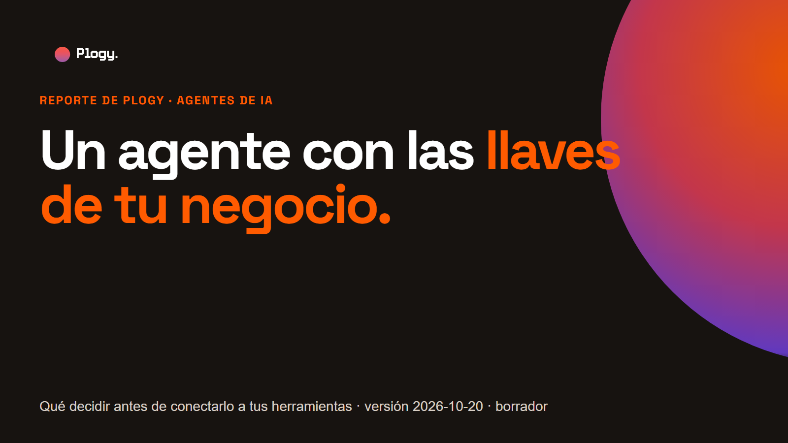
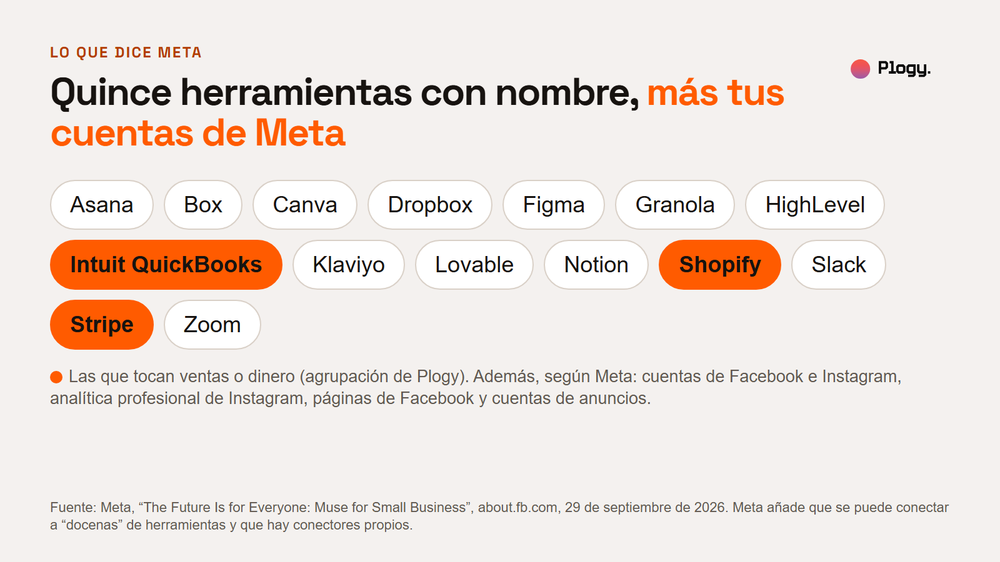
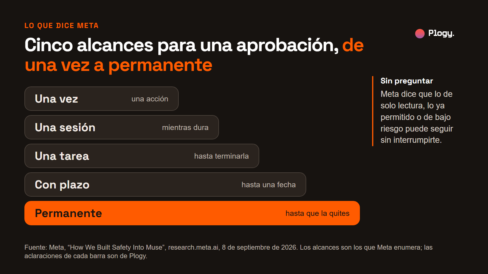
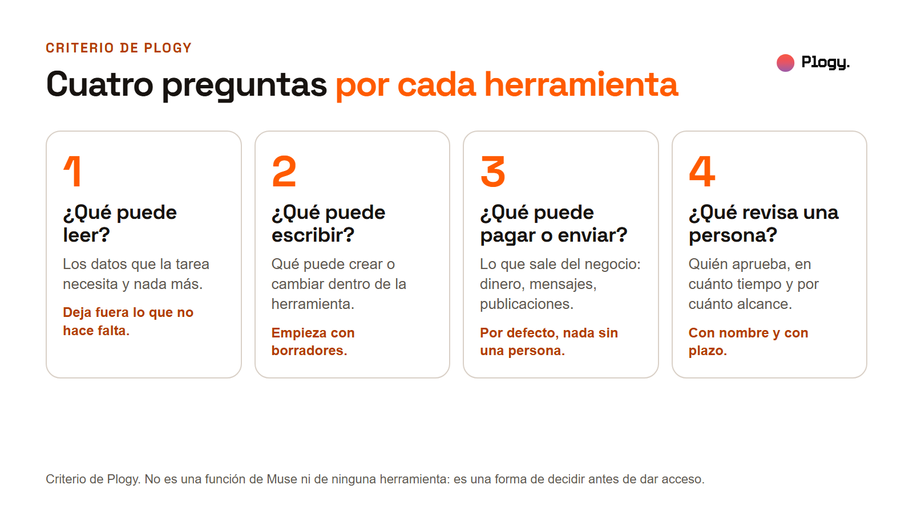
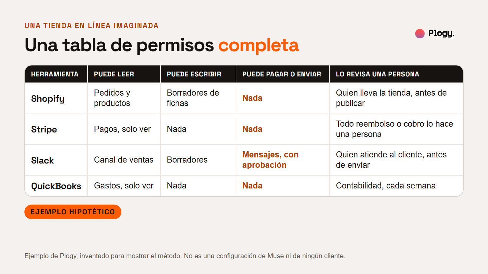
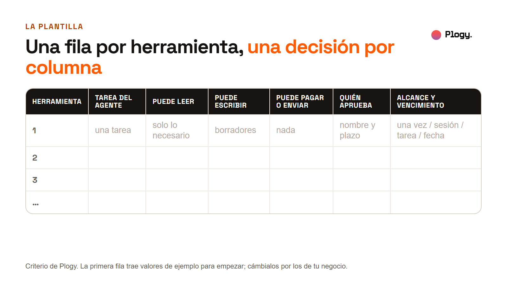
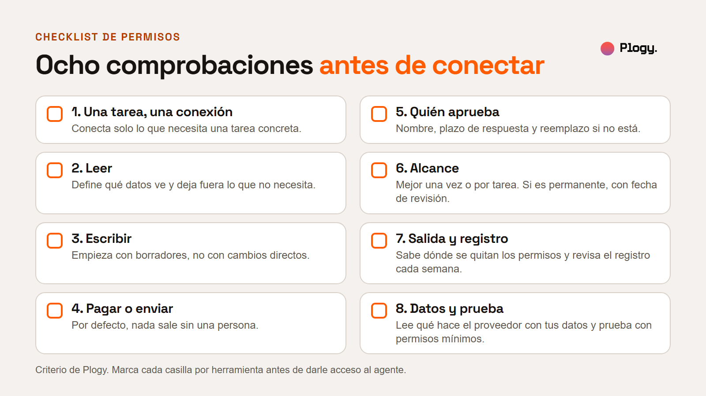

# Un agente con las llaves de tu negocio: qué decidir antes de conectarlo a tus herramientas

Reporte de Plogy · Pieza 007 · Palabra clave del carrusel: PERMISOS

- Estado: BORRADOR para revisión humana. No publicado.
- URL prevista: `/reportes/agente-con-llaves-de-tu-negocio` (por confirmar cuando se configure la web)
- Fecha de la versión: 2026-10-20
- Última actualización: 2026-10-20 (versión inicial)
- Pilar: Conocimiento · Audiencia: Negocios · Vertical: IA y automatizaciones
- Tipo: noticia explicada con un recurso práctico (checklist y plantilla)
- Autor y revisor: pendiente de asignar

## Resumen

1. El 29 de septiembre de 2026 Meta presentó Muse for Small Business, una versión de su agente Muse para dueños de negocio. Según Meta, se conecta a quince herramientas con nombre (entre ellas Shopify, Stripe, QuickBooks y Slack) y a cuentas de Facebook, Instagram y anuncios. Meta promete que nada se publica, se envía ni se gasta sin la aprobación del dueño.
2. Los propios documentos de Meta muestran que "aprobar" tiene alcances distintos (de una vez, de sesión, de tarea, con plazo o permanente) y que lo de solo lectura o ya permitido puede seguir sin preguntar. Meta también admite que Muse puede equivocarse y que los ataques con instrucciones escondidas siguen sin resolverse.
3. Esto vale para cualquier agente conectado a tus herramientas, no solo para Muse. Antes de conectarlo, decide qué puede leer, qué puede escribir, qué puede pagar o enviar y qué revisa una persona. Al final hay una plantilla de tabla de permisos y un checklist de ocho comprobaciones.

## 1. Qué pasó

Cada dato lleva su fuente. Lo de Meta viene de tres páginas de Meta que leímos (el anuncio, la nota de seguridad y la página de presentación de Muse). Lo de terceros se rotula. Plogy no ha probado Muse. Meta vende este producto: léelo sabiendo que es su propia versión.

### El anuncio

- **Fecha.** Meta publicó "The Future Is for Everyone: Muse for Small Business" el 29 de septiembre de 2026. La página muestra una actualización del 8 de octubre de 2026; no sabemos qué cambió. (Meta, sala de prensa.)
- **Qué es.** Muse for Small Business amplía Muse, un agente personal que hace tareas por el usuario. El dueño le da un objetivo, como encontrar clientes nuevos o analizar resultados, y el agente lo trabaja en varios pasos. (Meta, sala de prensa.)
- **Qué dice Meta que puede hacer.** Ejemplos de la propia Meta: analizar ventas, campañas y actividad en redes y armar un plan de crecimiento; revisar el desempeño financiero del mes y señalar gastos inusuales; avisar de correos que necesitan respuesta y escribir un primer borrador. (Meta, sala de prensa.)

### A qué se conecta

Meta nombra quince herramientas: Asana, Box, Canva, Dropbox, Figma, Granola, HighLevel, Intuit QuickBooks, Klaviyo, Lovable, Notion, Shopify, Slack, Stripe y Zoom. Además, cuentas de Facebook e Instagram, analítica profesional de Instagram, páginas de Facebook y cuentas de anuncios de Meta. Dice que puede conectarse a "docenas" de herramientas, que la lista completa está en los ajustes de la app y que hay conectores propios para servicios que todavía no soporta. (Meta, sala de prensa.)

### La promesa y los permisos

- **La promesa.** "Nothing publishes, sends, or spends without your approval" (en español, traducción nuestra: nada se publica, se envía ni se gasta sin tu aprobación). (Meta, sala de prensa.)
- **Cómo funcionan las aprobaciones.** En su nota de seguridad del 8 de septiembre, Meta describe un componente llamado Sentinel como "la única autoridad de permisos" para las acciones de los conectores. Las reglas que fija el usuario deciden si una acción se permite, se niega o pide confirmación. Meta dice que las aprobaciones son "capacidades estrictas, no sugerencias de conversación", atadas a un conector, un destino y un uso, y enumera cinco alcances: de una vez, de sesión, de tarea, con plazo o permanentes. (Meta Research. Traducción nuestra.)
- **Lo que puede seguir sin preguntar.** Según la misma nota, las acciones de solo lectura, las que ya permitiste antes o las de bajo riesgo pueden seguir sin interrumpirte.
- **Lectura y escritura.** Donde el servicio lo permite, Meta separa el acceso de lectura del de escritura y ofrece controles más finos que los permisos estándar de OAuth. (Meta Research.)
- **Dónde ver lo aprobado.** La página de presentación de Muse dice que el avatar muestra el registro de actividad y los permisos que aprobaste, y que Muse se detiene en las acciones difíciles de deshacer. (Meta, página de Muse.)

### Lo que Meta admite

En la misma nota de seguridad, Meta dice (traducción nuestra) que Muse "puede cometer errores y los cometerá", que "no es inmune a los ataques" y que la inyección de instrucciones "sigue siendo un problema abierto en la industria". Una inyección de instrucciones es una instrucción escondida en una página, un correo o un archivo que el agente lee y puede intentar obedecer. Meta cuenta con defensas (entrenamiento, clasificadores y aprobación para acciones que sacan datos) y ofrece hasta 130.000 dólares por reportar ciertos ataques con éxito.

También admite que su arquitectura actual limita el acceso de su personal mediante políticas operativas, pero "no impide que Meta acceda a los datos cuando es necesario", y que una versión totalmente privada es algo "próximo" y no existe aún. Los datos usados para entrenar se limpian de información personal clave y el usuario puede salirse con un interruptor en los ajustes. (Meta Research.)

### Disponibilidad y precio

- **Disponibilidad.** Meta dice que Muse está disponible en Estados Unidos y Canadá. Un tercero que buscamos habla solo de Estados Unidos; hay que confirmarlo antes de publicar. La nota de Meta no lista otros países ni idiomas.
- **Precio.** Según Meta, "Muse es gratis para la mayor parte de lo que la gente necesita" y hay planes de suscripción para quien quiera más. Meta no da precios ni límites en esa nota. TechCrunch lo describe como gratis con topes. (Meta, sala de prensa; TechCrunch.)

## 2. Qué se sabe y qué no

**Confirmado en páginas de Meta que leímos:** la fecha del anuncio (29 de septiembre de 2026), qué es Muse for Small Business, los quince conectores nombrados y las cuentas de Meta, la promesa de aprobación, los cinco alcances de aprobación, que lo de solo lectura o ya permitido puede seguir sin preguntar, las admisiones de errores y ataques, la disponibilidad en EE. UU. y Canadá y que es gratis para la mayor parte con planes de pago.

**Reportado por terceros:** TechCrunch (29 de septiembre) repite la lista de conectores, la fecha y el modelo gratis con topes, y dice que no tiene pruebas independientes del producto. Otras notas aparecieron en las búsquedas (The Next Web, Help Net Security, Small Business Trends y otras) pero no las leímos completas.

**Lo que no sabemos:**

- **Si Muse cumple su promesa en el uso real.** No encontramos una prueba independiente y Plogy no la ha probado.
- **Qué cambió en la actualización del 8 de octubre.** La página lo marca, pero no lo explica en lo que leímos.
- **Cómo se revoca un permiso o un conector.** Las páginas de Meta que leímos no lo describen.
- **Los precios de los planes.** Meta no los publica en lo que leímos. Algunos sitios de terceros dan cifras que no pudimos verificar y no las usamos.
- **Cuándo llegará a otros países, incluidos los de habla hispana.**
- **Qué cubren los términos y la política de privacidad de Meta.** No los leímos.

**Interés comercial de las fuentes.** Meta vende Muse (tiene un nivel gratis y planes de suscripción) y es dueña de las cuentas de Facebook, Instagram y anuncios a las que Muse se conecta. Su anuncio incluye una cita del cofundador de Canva, una de las herramientas conectadas. Plogy, por su parte, implementa IA en negocios y le conviene que las empresas piensen sus permisos con cuidado. Esta lectura es nuestra y no sale de Meta.

## 3. La lectura de Plogy

Un agente conectado no es una herramienta más. Actúa con las credenciales que le des: lo que puede hacer es lo que tu cuenta permite. Por eso la pregunta útil no es si Muse es bueno, sino qué le dejas hacer dentro de cada herramienta.

La promesa de Meta ("nada se publica, envía ni gasta sin tu aprobación") es un punto de partida. Lo que importa es lo que viene después: aprobar qué, con qué alcance y quién. Una aprobación permanente no se parece a una aprobación de una sola vez, y una acción de solo lectura puede seguir sin preguntar. Esa decisión es del negocio, no del agente ni del proveedor.

Hipótesis de Plogy, no medida: si el agente pide aprobación por cada paso, la gente termina aprobando sin leer. Por eso conviene decidir antes qué merece una persona y qué no, y no descubrirlo con el agente ya trabajando.

Todo esto vale para cualquier agente que se conecte a tus herramientas, sea de Meta o no.

## 4. Qué significa para tu negocio

Cuatro preguntas por cada herramienta que quieras conectar:

1. **¿Qué puede leer?** Solo los datos que la tarea necesita. Deja fuera lo que no hace falta.
2. **¿Qué puede escribir?** Qué puede crear o cambiar dentro de la herramienta. Empieza con borradores.
3. **¿Qué puede pagar o enviar?** Lo que sale del negocio: dinero, mensajes, publicaciones. Por defecto, nada sin una persona.
4. **¿Qué revisa una persona?** Quién aprueba, en cuánto tiempo y con qué alcance. Con nombre y con plazo.

### Un ejemplo, con datos inventados

**Ejemplo hipotético. No es una configuración de Muse ni de ningún cliente.** Imagina una tienda en línea que quiere que un agente le ayude con fichas de producto, mensajes de ventas y cuentas semanales. Una tabla de permisos razonable podría quedar así:

| Herramienta | Puede leer | Puede escribir | Puede pagar o enviar | Lo revisa una persona |
| --- | --- | --- | --- | --- |
| Shopify | Pedidos y productos | Borradores de fichas | Nada | Quien lleva la tienda, antes de publicar |
| Stripe | Pagos, solo ver | Nada | Nada | Todo reembolso o cobro lo hace una persona |
| Slack | Canal de ventas | Borradores | Mensajes, con aprobación | Quien atiende al cliente, antes de enviar |
| QuickBooks | Gastos, solo ver | Nada | Nada | Contabilidad, cada semana |

Lo que el ejemplo no resuelve: si cada herramienta ofrece de verdad esos permisos separados. Eso depende de la herramienta y de cómo se conecte el agente, y hay que comprobarlo en cada una.

## 5. La plantilla de tabla de permisos

Una fila por herramienta y una decisión por columna. Cópiala a una hoja de cálculo:

| Herramienta | Tarea del agente | Puede leer | Puede escribir | Puede pagar o enviar | Quién aprueba | Alcance y vencimiento |
| --- | --- | --- | --- | --- | --- | --- |
| 1 | una tarea | solo lo necesario | borradores | nada | nombre y plazo | una vez / sesión / tarea / fecha |
| 2 | | | | | | |
| 3 | | | | | | |

## 6. El checklist de permisos

Marca cada casilla por herramienta antes de darle acceso al agente:

- [ ] **1. Una tarea, una conexión.** Conecta solo lo que necesita una tarea concreta.
- [ ] **2. Leer.** Define qué datos puede ver y deja fuera lo que la tarea no necesita (por ejemplo, nómina o datos personales de clientes).
- [ ] **3. Escribir.** Empieza con borradores. Los cambios directos solo cuando los borradores ya salieron bien varias veces.
- [ ] **4. Pagar o enviar.** Por defecto, nada sale sin una persona: cobros, reembolsos, mensajes, publicaciones.
- [ ] **5. Quién aprueba.** Un nombre, un plazo de respuesta y un reemplazo si esa persona no está.
- [ ] **6. Alcance.** Prefiere aprobar una vez o por tarea. Si algo es permanente, ponle una fecha de revisión.
- [ ] **7. Salida y registro.** Sabe dónde se quitan los permisos y quién lo hace. Revisa el registro de actividad cada semana.
- [ ] **8. Datos y prueba.** Lee qué hace el proveedor con tus datos (quién puede acceder, si se usan para entrenar, cómo se borran) y prueba primero con datos de prueba o permisos mínimos.

## 7. Qué haría Plogy primero

Es criterio de Plogy, no un hecho de fuentes externas, y todavía no lo hemos aplicado a un cliente. Antes de conectar un agente, elegiría una sola tarea y una sola herramienta, y empezaría con acceso de solo lectura. Compararía lo que el agente produce con lo que haría una persona durante un tiempo corto, y solo después abriría borradores. Dejaría pagos y envíos para el final, con aprobación de una persona con nombre. Escribiría la tabla de permisos antes de dar el acceso y la revisaría cuando algo cambie.

## 8. Lo que este reporte no cubre

- **Si Muse cumple su promesa.** No lo hemos probado y no encontramos una prueba independiente.
- **Los términos y la política de privacidad de Meta.** No los leímos. Antes de conectar datos de clientes, léelos o consulta a quien lleve lo legal de tu negocio, sobre todo si tratas datos personales.
- **Otros agentes.** Hay agentes de otras empresas con permisos propios. El checklist sirve igual, pero cada uno tiene sus controles.
- **Cómo se revoca un conector en Muse.** Las páginas de Meta que leímos no lo describen.
- **Precios y países.** Meta no da precios en la nota que leímos y la disponibilidad que dice es EE. UU. y Canadá.
- **Seguridad técnica a fondo.** El reporte no es una auditoría de seguridad.

## 9. Fuentes

Consultadas el 2026-10-20. Leídas directamente (a través de una herramienta de lectura de páginas web que devuelve un resumen del texto, por lo que las citas textuales deben compararse con la página antes de publicar):

- Meta, "The Future Is for Everyone: Muse for Small Business", 29 de septiembre de 2026 (actualizada el 8 de octubre): https://about.fb.com/news/2026/09/introducing-muse-small-business/
- Meta Research, "How We Built Safety Into Muse", 8 de septiembre de 2026, autor: Tarek Sheasha: https://research.meta.ai/blog/security-and-safety-for-ai-agents-our-approach-with-muse (la dirección security.muse.ai redirige aquí)
- Meta, página de presentación de Muse (septiembre de 2026): https://introducing.muse.ai
- TechCrunch, "Meta is expanding its AI agent Muse to small businesses", 29 de septiembre de 2026: https://techcrunch.com/2026/09/29/meta-is-expanding-its-ai-agent-muse-to-small-businesses/

Aparecieron en las búsquedas y no se leyeron completas: The Next Web, Help Net Security, Small Business Trends, Fox Business, AI Business y otros.

## 10. Siguiente paso

Sigue a Plogy para ver cómo se implementa la IA en negocios, con permisos pensados antes de dar acceso.

## Historial de cambios

- 2026-10-20: versión inicial en borrador, con portada, seis figuras, una foto de la biblioteca, la plantilla de tabla de permisos y el checklist.
