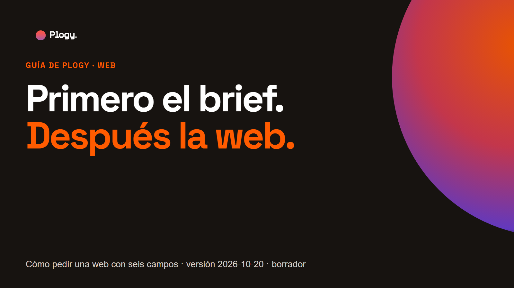
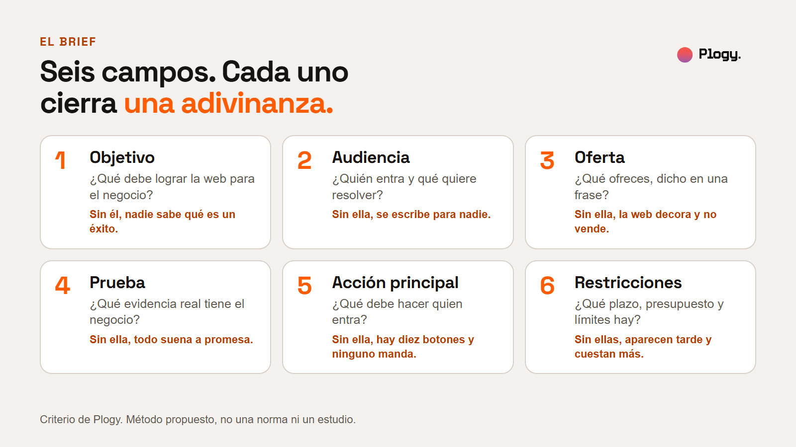
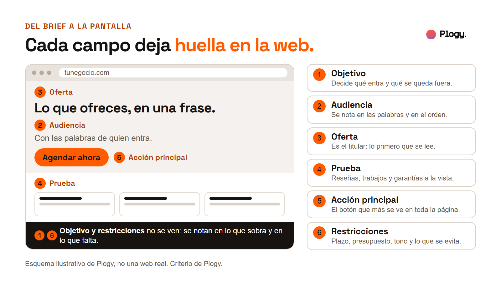
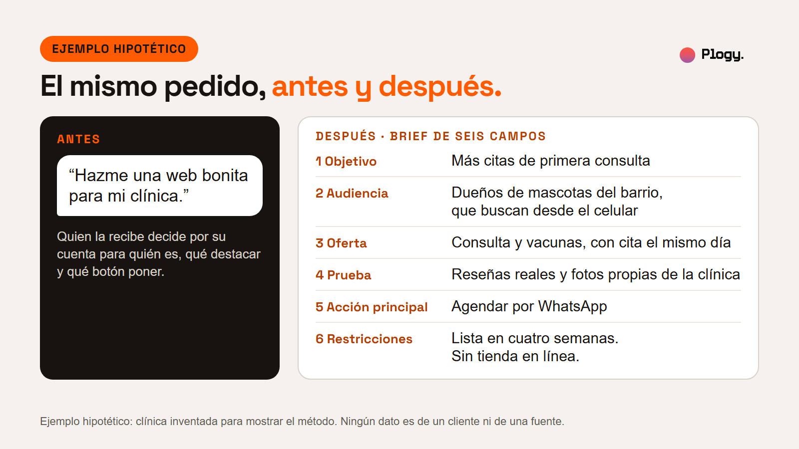
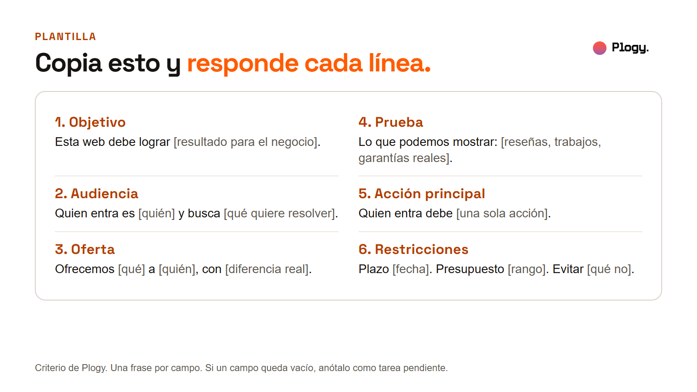
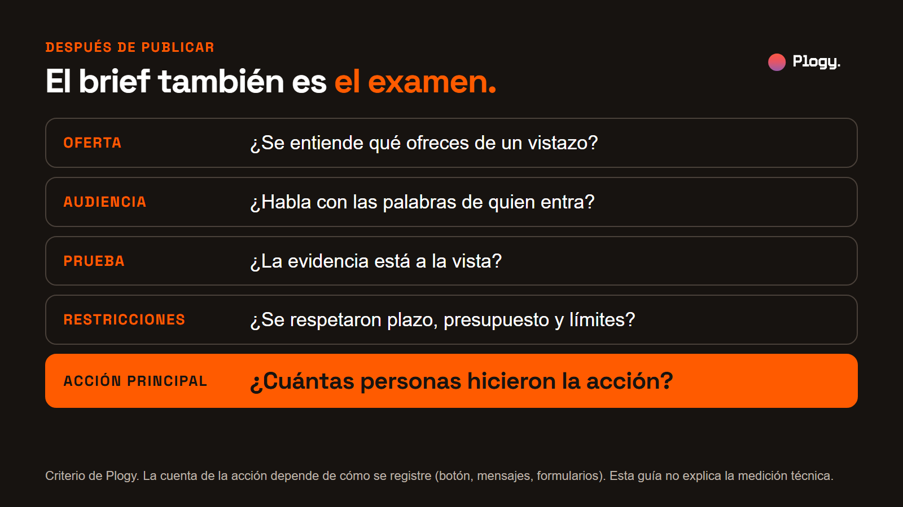

# Primero el brief, después la web: guía para pedir una web con seis campos



Guía de Plogy · Pieza 010 · Palabra clave del carrusel: BRIEF

- Estado: BORRADOR para revisión humana. No publicado.
- URL prevista: `/guias/brief-de-web` (por confirmar cuando se configure la web)
- Fecha de la versión: 2026-10-20
- Última actualización: 2026-10-20 (versión inicial)
- Pilar: Conocimiento · Audiencia: Negocios · Vertical: Web
- Tipo: guía educativa. No parte de una noticia.
- Autor y revisor: pendiente de asignar

## Resumen

1. "Hazme una web bonita" es un deseo, no un pedido. Quien lo recibe, sea una IA o un equipo, tiene que adivinar para quién es, qué destacar y qué debe pasar.
2. Un brief de seis campos evita esas adivinanzas: objetivo, audiencia, oferta, prueba, acción principal y restricciones.
3. Cada campo se ve en la pantalla final, y los mismos campos dan las preguntas para revisar la web cuando esté lista.
4. La pregunta más importante de esa revisión es si la web logró la acción principal.
5. Al final hay una plantilla copiable y un ejemplo completo, con cifras y negocio inventados.

## 1. El error típico: pedir una web bonita

El pedido más común es una frase: "hazme una web bonita para mi negocio". Funciona como deseo, pero no como instrucción. "Bonita" no dice para quién es, qué se vende, qué debe hacer quien entra ni qué límites hay. Con el mismo pedido, una IA o un equipo pueden entregar una web sobria, una llamativa o una elegante, y las tres cumplen la frase.

Ahí está el problema: si todas las versiones cumplen lo que se pidió, ninguna se puede juzgar. La discusión después se vuelve de gustos ("no me convence") y cada ronda de cambios intenta acertar lo que el brief no dijo.

Esta guía es criterio de Plogy. No cita estudios ni cifras de terceros, y el ejemplo del final es inventado y está rotulado.

## 2. Los seis campos



1. **Objetivo.** Qué debe lograr la web para el negocio. Una frase con un resultado, por ejemplo "más citas de primera consulta". "Verse profesional" no es un objetivo: es una condición.
2. **Audiencia.** Quién entra y qué quiere resolver. Cuanto más concreta, mejor: "dueños de mascotas del barrio que buscan desde el celular" dice más que "todo el mundo".
3. **Oferta.** Qué ofreces, dicho en una frase que alguien ajeno al negocio entienda. Esa frase suele convertirse en el titular de la web.
4. **Prueba.** Qué evidencia real tiene el negocio: reseñas de clientes con su permiso, trabajos hechos con fotos propias, garantías o certificaciones que existen, años de oficio si son ciertos. La prueba no se inventa; se junta. Si todavía no existe, se anota en el brief como tarea pendiente, no como hueco que alguien rellena con promesas.
5. **Acción principal.** Qué debe hacer quien entra. Una sola: agendar, llamar, escribir por WhatsApp, comprar. Si hay varias, se ordenan y una manda.
6. **Restricciones.** Plazo, presupuesto, tono, cosas que no deben aparecer, herramientas que ya se usan (el dominio, el logo, el sistema de citas). Entre más tarde aparece una restricción, más cuesta.

## 3. Cada campo se ve en la pantalla



- La **oferta** es el titular: lo primero que se lee.
- La **audiencia** se nota en las palabras y en el orden de lo que se cuenta.
- La **prueba** debe estar a la vista, sin obligar a buscarla.
- La **acción principal** es el botón que más se ve en toda la página.
- El **objetivo** y las **restricciones** no se ven directamente. Se notan en lo que sobra y en lo que falta: si hay secciones que no sirven al objetivo, o si se pasó el plazo o el presupuesto, el brief no se usó.

## 4. Un ejemplo, con negocio inventado

**Ejemplo hipotético. Ningún dato es de un cliente ni de una fuente.** Imagina una clínica veterinaria pequeña. Antes, pide: "hazme una web bonita para mi clínica". Después, con el brief:



| Campo | Respuesta (hipotética) |
| --- | --- |
| Objetivo | Más citas de primera consulta |
| Audiencia | Dueños de mascotas del barrio, que buscan desde el celular |
| Oferta | Consulta y vacunas, con cita el mismo día |
| Prueba | Reseñas reales y fotos propias de la clínica |
| Acción principal | Agendar por WhatsApp |
| Restricciones | Lista en cuatro semanas. Sin tienda en línea. |

Con el pedido original, nadie sabe si importa más el diseño, la ubicación o los precios. Con el brief, la web tiene un titular (la oferta), un botón que manda (agendar por WhatsApp), una sección de prueba (reseñas y fotos propias) y un límite claro de alcance (nada de tienda en línea). Lo que el ejemplo no dice es cuánto cuesta construirla ni cuántas citas traerá: eso depende del negocio y no se promete aquí.

## 5. Cómo usarlo con una IA y con un equipo

- **Con una IA.** Pega el brief completo al inicio de la conversación. Antes de que construya nada, pídele que enumere lo que le falta y lo que está suponiendo, y respóndele. Así las adivinanzas se vuelven preguntas.
- **Con un equipo o una agencia.** Entrega el brief antes de la primera reunión y úsalo como orden del día: cada campo es un tema. Pide que las propuestas indiquen cómo atiende cada uno.
- **En ambos casos.** Si un campo no se puede responder todavía, no lo dejes en blanco: escribe qué falta y quién lo resuelve.

## 6. La plantilla

Una frase por campo. Cópiala y reemplaza lo que está entre corchetes:

```
BRIEF DE WEB

1. Objetivo
Esta web debe lograr [resultado para el negocio].

2. Audiencia
Quien entra es [quién] y busca [qué quiere resolver].

3. Oferta
Ofrecemos [qué] a [quién], con [diferencia real].

4. Prueba
Lo que podemos mostrar: [reseñas, trabajos, garantías reales].
Lo que todavía no tenemos: [tareas pendientes].

5. Acción principal
Quien entra debe [una sola acción].

6. Restricciones
Plazo: [fecha]. Presupuesto: [rango].
Evitar: [qué no]. Ya existe: [dominio, logo, sistema de citas].
```



El mismo brief ya llenado, con la clínica inventada del ejemplo:

```
BRIEF DE WEB (ejemplo hipotético)

1. Objetivo
Esta web debe lograr más citas de primera consulta.

2. Audiencia
Quien entra es un dueño de mascota del barrio y busca una consulta o vacunas desde el celular.

3. Oferta
Ofrecemos consulta general y vacunas a dueños de perros y gatos, con cita el mismo día.

4. Prueba
Lo que podemos mostrar: reseñas reales con permiso y fotos propias de la clínica.
Lo que todavía no tenemos: pedir permiso a los clientes para publicar sus reseñas.

5. Acción principal
Quien entra debe agendar una cita por WhatsApp.

6. Restricciones
Plazo: cuatro semanas. Presupuesto: [por definir].
Evitar: tienda en línea. Ya existe: logo y número de WhatsApp.
```

## 7. Lo que el brief permite comprobar



Un brief sirve dos veces: para pedir y para revisar. Cuando la web esté lista, vuelve a los campos y pregunta (el objetivo se comprueba con la última):

- **Oferta:** ¿se entiende qué ofreces de un vistazo?
- **Audiencia:** ¿habla con las palabras de quien entra?
- **Prueba:** ¿la evidencia está a la vista?
- **Restricciones:** ¿se respetaron plazo, presupuesto y límites?
- **Acción principal:** ¿cuántas personas hicieron la acción?

La última es la que decide si la web funcionó. Con una acción única y definida (agendar por WhatsApp), se puede contar cuántas personas la hicieron durante las primeras semanas, comparar con lo que se esperaba y ajustar. Sin ella, la revisión vuelve a ser de gustos.


## 8. Qué haría Plogy primero

Es criterio de Plogy, no un hecho de fuentes externas. Antes de abrir un editor o una herramienta de IA, llenaría estos seis campos con la persona del negocio, anotando lo que falta (casi siempre, la prueba), y los dejaría por escrito. Después construiría contra ese documento y, al terminar, revisaría la web con las cinco preguntas de la sección 7. Esta guía todavía no se ha aplicado a un cliente de Plogy.

## 9. Lo que esta guía no cubre

- **Diseño visual e identidad de marca.** El brief dice qué debe lograr la web, no cómo debe verse. El estilo, los colores y las fuentes son otra conversación.
- **Los textos finales.** El brief da la oferta y la audiencia; redactar la web completa es un paso posterior.
- **Desarrollo, hosting y dominio.** Elegir herramientas y publicar queda fuera.
- **Posicionamiento en buscadores y medición técnica.** Cómo registrar las acciones (botón, mensajes, formularios) depende de las herramientas y no se explica aquí.
- **Costos y presupuestos.** No hay cifras de referencia de lo que cuesta una web.
- **Aspectos legales.** Permisos de reseñas e imágenes, políticas de privacidad y avisos requieren revisión propia.

## 10. Fuentes

No hay fuentes externas. El contenido es criterio de Plogy, con un ejemplo de negocio y datos inventados rotulado como hipotético. Una revisión humana puede añadir referencias de diseño web o de gestión de proyectos si lo considera útil. Pendiente.

## 11. Siguiente paso

Sigue a Plogy para ver cómo se implementa la tecnología en negocios, empezando por pedir bien lo que se quiere construir.

## Historial de cambios

- 2026-10-20: versión inicial en borrador, con portada, cinco figuras, la plantilla (en figura y en texto copiable), un ejemplo completo y una imagen de la biblioteca. Las figuras se generan desde `reporte-figuras.html`.
