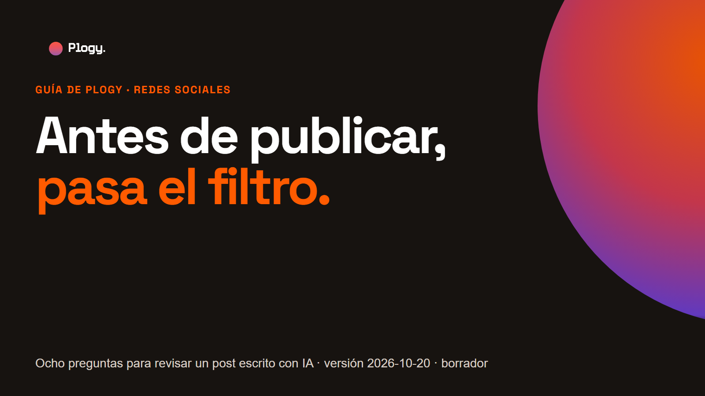
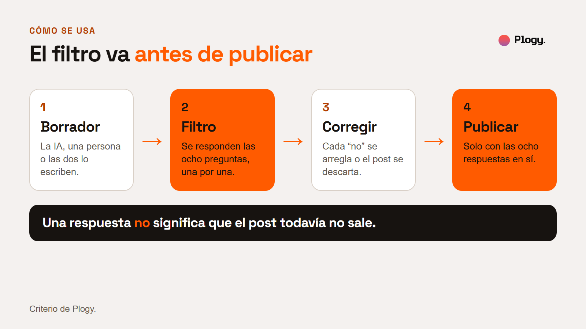
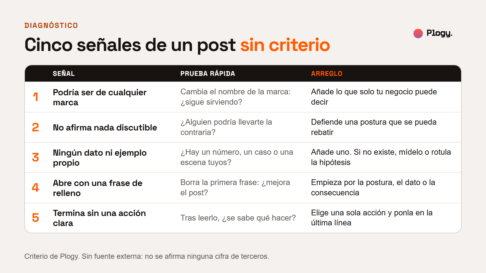
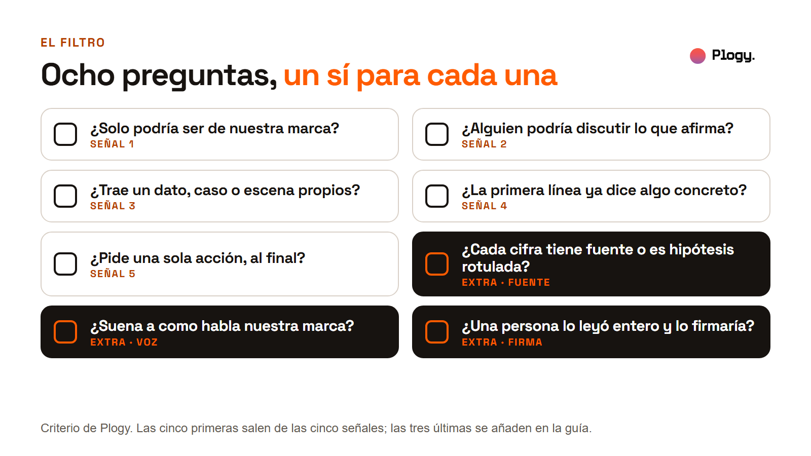
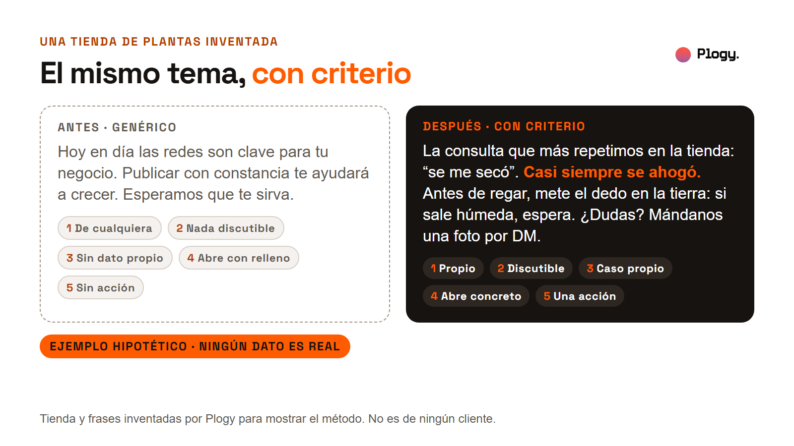

# Antes de publicar, pasa el filtro: ocho preguntas para revisar un post escrito con IA

Guía de Plogy · Pieza 011 · Palabra clave del carrusel: FILTRO

- Estado: BORRADOR para revisión humana. No publicado.
- URL prevista: `/guias/filtro-para-revisar-un-post` (por confirmar cuando se configure la web)
- Fecha de la versión: 2026-10-20
- Última actualización: 2026-10-20 (versión inicial)
- Pilar: Conocimiento · Audiencia: Negocios · Vertical: Redes sociales
- Tipo: guía educativa. No parte de una noticia.
- Autor y revisor: pendiente de asignar

## Resumen

1. Un post escrito con IA sale sin criterio cuando nadie decidió qué dice, con qué prueba y para qué. Se nota en cinco señales.
2. Cada señal tiene una prueba rápida y un arreglo que es de edición, no de herramienta.
3. Las cinco señales, más tres comprobaciones (fuente, voz y firma), forman un filtro de ocho preguntas que se responde antes de publicar.
4. Si una respuesta es no, el post todavía no sale: se corrige o se descarta.

## 1. La idea

Tener criterio, en un post, es que alguien haya decidido algo: qué afirma la marca, con qué dato o caso lo sostiene y qué quiere que haga quien lo lea. La IA puede escribir el borrador en segundos. Esas decisiones no vienen incluidas en el borrador, y cuando faltan el post queda correcto pero intercambiable.

Esta guía no pide dejar de usar IA para escribir. Propone un paso de revisión entre el borrador y la publicación, con preguntas que se responden con sí o no.

## 2. Las cinco señales y su arreglo

1. **Podría ser de cualquier marca.** Prueba: cambia el nombre de la marca por el de otra. Si el post sigue sirviendo, es genérico. Arreglo: añade algo que solo tu negocio puede decir, como un producto, un cliente o una decisión.
2. **No afirma nada discutible.** Prueba: ¿alguien podría decir "no estoy de acuerdo"? Si nadie podría, tampoco habrá quien lo recuerde. Arreglo: escribe una postura que se pueda rebatir y defiéndela con lo que sabes.
3. **Ningún dato ni ejemplo propio.** Prueba: ¿hay un número, un caso o una escena de tu negocio? Arreglo: añade uno. Si todavía no existe, mídelo. Si es una suposición, se rotula como hipótesis. Nunca se inventa un cliente ni una cifra.
4. **Abre con una frase de relleno.** Prueba: borra la primera frase. Si el post mejora, esa frase sobraba. Arreglo: empieza por la postura, el dato o la consecuencia.
5. **Termina sin una acción clara.** Prueba: después de leerlo, ¿se sabe qué hacer? Arreglo: elige una sola acción (comentar, escribir por mensaje, visitar una página) y ponla en la última línea.

## 3. El filtro de ocho preguntas

Se responde con sí o no, con el post delante. Cada pregunta dice qué cuenta como sí.

Una copia para llevar a una hoja de cálculo o a un documento:

- [ ] **1. ¿Solo podría ser de nuestra marca?** Sí cuando el post nombra algo propio (un producto, un cliente, una decisión) y no funcionaría con otro nombre.
- [ ] **2. ¿Alguien podría discutir lo que afirma?** Sí cuando hay una postura que una persona razonable podría rebatir.
- [ ] **3. ¿Trae un dato, caso o escena propios?** Sí cuando hay un número, un caso o una escena de tu negocio, o una hipótesis rotulada como tal.
- [ ] **4. ¿La primera línea ya dice algo concreto?** Sí cuando se puede leer sola y aporta información o postura.
- [ ] **5. ¿Pide una sola acción, al final?** Sí cuando hay exactamente una acción y está en la última línea.
- [ ] **6. ¿Cada cifra tiene fuente o es una hipótesis rotulada?** Sí cuando se puede decir de dónde sale cada número, o el post dice que es un ejemplo inventado.
- [ ] **7. ¿Suena a como habla nuestra marca?** Sí cuando, leído en voz alta, alguien del equipo diría esas frases en una conversación.
- [ ] **8. ¿Una persona lo leyó entero y lo firmaría?** Sí cuando una persona con nombre lo leyó completo y acepta que salga a nombre de la marca.

Las preguntas 1 a 5 salen de las cinco señales. Las preguntas 6 a 8 cubren tres riesgos que las señales no miden: que un dato sea falso, que el texto suene a otra voz y que nadie responda por él.

## 4. Cómo usarlo

1. **Escribe el borrador** (con IA, a mano o mezclado).
2. **Responde las ocho preguntas** con el post a la vista, una por una. Responde con sí o no, sin "más o menos".
3. **Corrige cada no.** Casi todos los arreglos son de edición: una frase propia, una postura, un dato, una acción. Si no hay nada propio que decir sobre el tema, descarta el post.
4. **Publica solo con las ocho respuestas en sí.**
5. **Anota qué preguntas fallan más.** Si siempre falla la 3, falta un archivo de datos y casos propios; si siempre falla la 7, falta una descripción escrita de la voz de la marca.

## 5. Un ejemplo, con una tienda inventada

**Ejemplo hipotético. La tienda y las frases son inventadas y no pertenecen a ningún cliente.** Un post genérico y su versión con criterio, sobre el mismo tema:

> **Antes:** Hoy en día las redes son clave para tu negocio. Publicar con constancia te ayudará a crecer. Esperamos que te sirva.

El antes falla las cinco señales: sirve para cualquier marca, no afirma nada discutible, no trae dato ni caso, abre con relleno y termina sin acción.

> **Después (una tienda de plantas inventada):** La consulta que más repetimos en la tienda: "se me secó". Casi siempre se ahogó. Antes de regar, mete el dedo en la tierra: si sale húmeda, espera. ¿Dudas? Mándanos una foto por DM.

El después nombra algo propio (una tienda de plantas), defiende una postura que alguien podría discutir, se apoya en un caso de la tienda, abre con lo concreto y pide una sola acción. Nota: en el ejemplo, "casi siempre" es una afirmación inventada. En un post real habría que poder sostenerla con lo que se ve en la tienda, o suavizarla.

Lo que el ejemplo no dice: si el post con criterio tiene más alcance o más ventas. Este método no mide alcance.

## 6. Qué haría Plogy primero

Es criterio de Plogy, no un hecho de fuentes externas. Antes de pedirle un borrador a una IA, escribiría tres líneas: qué postura defiende la marca en este post, qué dato o caso propio lo sostiene y qué acción pide al final. Con eso en el encargo, el borrador parte con las señales 1 a 5 ya resueltas. Después pasaría el filtro de ocho preguntas con una persona del equipo. Esta guía todavía no se ha aplicado a un cliente de Plogy.

## 7. Lo que esta guía no cubre

- **Si un texto lo escribió una IA.** El filtro revisa el criterio del post, no su origen. Un post escrito a mano también puede fallar las ocho preguntas.
- **Alcance, interacción o ventas.** No hay evidencia en esta guía de que pasar el filtro mejore esas cifras.
- **Revisión legal o de derechos.** No sustituye revisar derechos de imágenes, testimonios, promociones ni normas de publicidad aplicables.
- **La definición de la voz de la marca.** La pregunta 7 supone que la marca ya sabe cómo habla. Si no, conviene escribirla antes.
- **Verificar los hechos del post.** La pregunta 6 pide tener la fuente a mano, no comprueba por ti que sea correcta.

## 8. Fuentes

No hay fuentes externas. El contenido es criterio de Plogy, con un ejemplo hipotético rotulado como tal. Una revisión humana puede añadir referencias de comunicación o de edición si lo considera útil. Pendiente.

## 9. Siguiente paso

Sigue a Plogy para ver cómo se implementa la IA en negocios, incluida la revisión de lo que se publica con ella.

## Historial de cambios

- 2026-10-20: versión inicial en borrador, con portada, cuatro figuras y la lista de comprobación de ocho preguntas. Las figuras se generan desde `reporte-figuras.html`.
