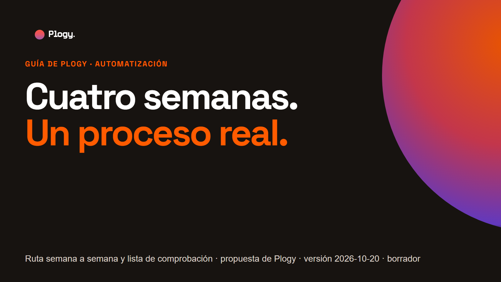
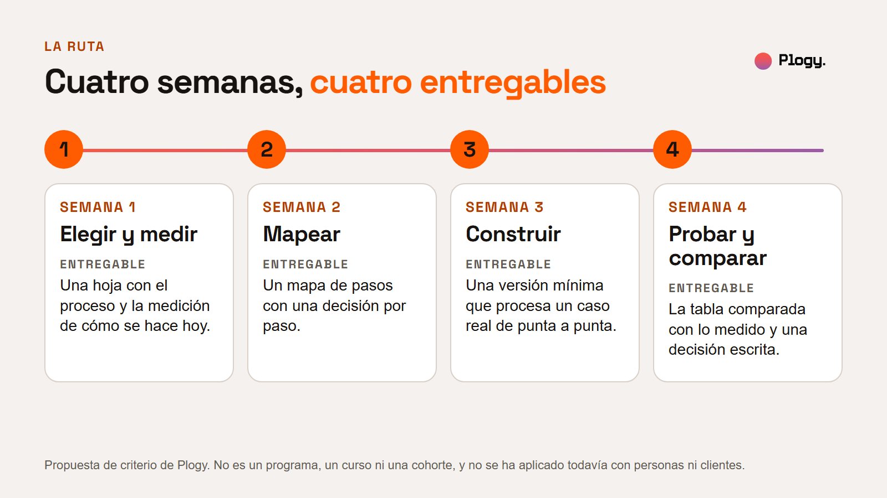
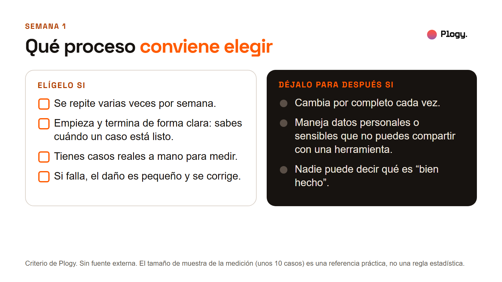
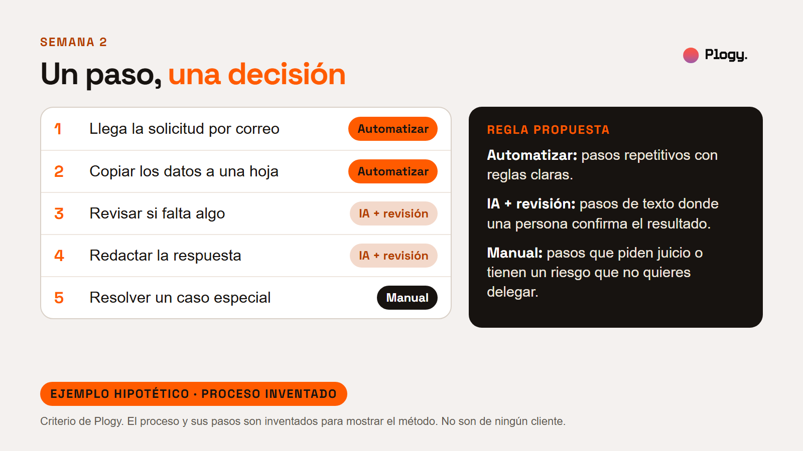
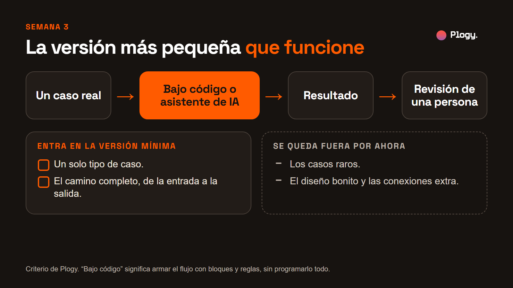
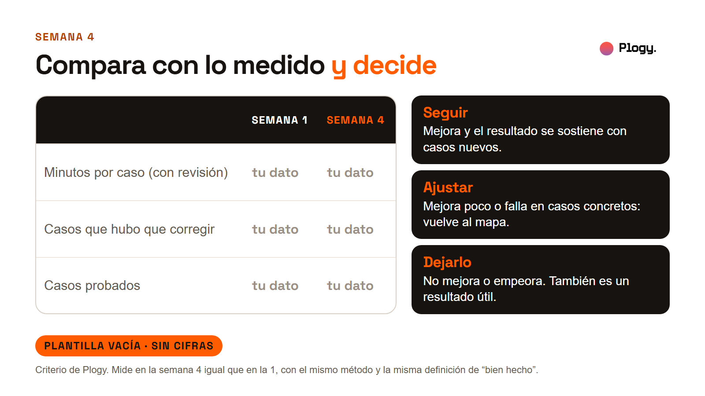
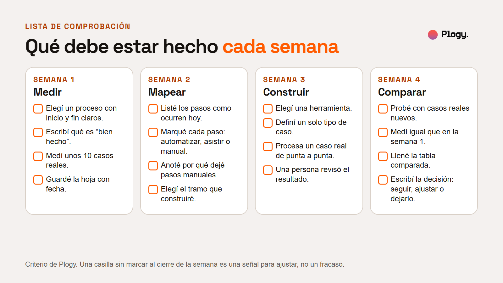

# Cuatro semanas, un proceso real: ruta para aprender a automatizar

Guía de Plogy · Pieza 012 · Palabra clave del carrusel: RUTA

- Estado: BORRADOR para revisión humana. No publicado.
- URL prevista: `/guias/ruta-de-cuatro-semanas` (por confirmar cuando se configure la web)
- Fecha de la versión: 2026-10-20
- Última actualización: 2026-10-20 (versión inicial)
- Pilar: Conocimiento (secundario: Filosofía) · Audiencia: Ploggers · Vertical: IA y automatizaciones
- Tipo: guía educativa. No parte de una noticia.
- Autor y revisor: pendiente de asignar

## Resumen

1. Se aprende a automatizar haciéndolo con un proceso real, no viendo herramientas sueltas. Esta guía propone una ruta de cuatro semanas.
2. Cada semana tiene una tarea y un entregable: una hoja con la medición de hoy, un mapa de pasos con una decisión por paso, una versión mínima que funciona y una tabla comparada con una decisión.
3. Lo que mides en la semana 1 es lo que te permite juzgar el resultado en la semana 4.
4. Al final hay una lista de comprobación para cerrar cada semana.

**Qué es y qué no es.** Es una propuesta de criterio de Plogy. No es un programa, un curso ni una cohorte, y todavía no se ha aplicado con personas ni con clientes. Puedes adaptarla a tu ritmo: la ruta fija entregables, no horas.

## 1. La idea

Un tutorial enseña una herramienta con un ejemplo limpio: sin casos raros, sin personas que lo usen, sin nadie que espere el resultado. Un proceso real obliga a decidir: qué se automatiza, qué no, cómo sabes que funcionó. Por eso la ruta parte de un proceso real y se organiza alrededor de lo que entregas cada semana.

| Semana | Tarea | Entregable |
| --- | --- | --- |
| 1 | Elegir un proceso y medir cómo se hace hoy | Una hoja con el proceso, qué es "bien hecho" y la medición de unos 10 casos reales |
| 2 | Mapear los pasos y decidir cuáles automatizar | Un mapa de pasos con cada paso marcado: automatizar, asistir con IA o manual |
| 3 | Construir una versión mínima | Una versión que procesa un caso real de punta a punta |
| 4 | Probar con casos reales y comparar | Una tabla comparada con lo medido y una decisión escrita |

## 2. Semana 1: elegir y medir

**Tarea.** Elige un proceso, define cuándo un caso está bien hecho y mide cómo se hace hoy.

1. **Elige un proceso.** Conviene que se repita varias veces por semana, que empiece y termine de forma clara, que tengas casos reales a mano y que, si falla, el daño sea pequeño y se pueda corregir.
2. **Déjalo para después** si cambia por completo cada vez, si maneja datos personales o sensibles que no puedes compartir con una herramienta, o si nadie puede decir qué es "bien hecho".
3. **Define "bien hecho".** Escribe en una o dos frases cuándo un caso está listo. Sin esa definición no se puede contar lo que hubo que corregir.
4. **Mide unos 10 casos reales.** Por cada caso anota quién lo hizo, cuántos minutos tardó, si hubo que corregirlo y cuántos minutos costó la corrección. La cifra de 10 es una referencia práctica, no una regla estadística.
5. **Guarda la hoja con fecha** y anota cómo mediste, para repetir el método en la semana 4.

**Entregable.** Una hoja con el proceso, la definición de "bien hecho" y la medición de unos 10 casos reales.

**Cómo sabes que terminaste.** Puedes decir, con datos tuyos, cuántos minutos tarda hoy un caso y cuántos casos hubo que corregir.

## 3. Semana 2: mapear y decidir

**Tarea.** Escribe los pasos tal como ocurren hoy, no como deberían ocurrir, y decide qué hacer con cada uno.

1. **Lista los pasos** en orden, con el nombre que les da quien hace el trabajo.
2. **Pregúntale a cada paso** si es repetitivo, si tiene reglas claras y qué pasa si sale mal.
3. **Marca una decisión por paso.** Regla propuesta: automatizar los pasos repetitivos con reglas claras; IA con revisión en los pasos de texto donde una persona confirma el resultado; manual en los que piden juicio o tienen un riesgo que no quieres delegar.
4. **Anota por qué** dejaste cada paso manual. Es información útil, no un fracaso.
5. **Elige el tramo que vas a construir:** el más corto de pasos seguidos que quite trabajo.

**Ejemplo hipotético.** Un proceso inventado de responder solicitudes de información: llegar por correo (automatizar), copiar los datos a una hoja (automatizar), revisar si falta algo (IA con revisión), redactar la respuesta (IA con revisión) y resolver un caso especial (manual). No es de ningún cliente.

**Entregable.** Un mapa de pasos con cada paso marcado: automatizar, asistir con IA o manual.

## 4. Semana 3: construir la versión mínima

**Tarea.** Construye la versión más pequeña que funcione, de la entrada a la salida, con una herramienta de bajo código o un asistente de IA.

- **Bajo código** significa armar el flujo con bloques y reglas, sin programarlo todo. **Asistente de IA** significa darle instrucciones y ejemplos y revisar lo que devuelve. Esta guía no recomienda una marca: usa la que ya puedas manejar con tus datos y tus permisos.
- **Un solo tipo de caso.** Los casos raros se quedan fuera por ahora.
- **De punta a punta, aunque sea feo.** Una versión fea que funciona completa enseña más que una versión pulida a medias.
- **Una persona revisa cada resultado.** Si pruebas con datos de otras personas o de un negocio, comprueba antes que puedes usarlos con esa herramienta.
- **Guarda las instrucciones o la configuración** que usaste, para poder repetirlo.

**Entregable.** Una versión mínima que procesa un caso real de punta a punta.

**Si no funciona con el primer caso,** simplifica: menos pasos, un caso más sencillo, instrucciones más claras.

## 5. Semana 4: probar y comparar

**Tarea.** Prueba con casos reales nuevos y compara con lo que mediste en la semana 1.

1. **Usa casos reales distintos** de los que usaste para construir.
2. **Mide igual que en la semana 1:** los mismos números, la misma definición de "bien hecho". Suma el tiempo de revisar el resultado.
3. **Llena la tabla comparada** (abajo).
4. **Decide por escrito:** seguir si mejora y se sostiene con casos nuevos; ajustar si mejora poco o falla en casos concretos (vuelve al mapa); dejarlo si no mejora o empeora. Dejarlo también es un resultado útil.
5. **Anota aparte** cuánto tiempo te costó construirlo. No está en la tabla y también cuenta al decidir.

Tabla comparada, para copiar a una hoja de cálculo:

| | Semana 1 | Semana 4 |
| --- | --- | --- |
| Minutos por caso (con revisión) | | |
| Casos que hubo que corregir | | |
| Casos probados | | |

**Entregable.** La tabla comparada y una decisión escrita.

## 6. Qué haría Plogy primero

Es criterio de Plogy, no un hecho de fuentes externas. Antes de tocar una herramienta mediría un solo proceso y dejaría la medición escrita. Después mapearía, construiría lo mínimo y volvería a medir igual. Esta ruta todavía no se ha aplicado con personas ni con clientes de Plogy.

## 7. Lista de comprobación semanal

Al cerrar la **semana 1**:

- [ ] Elegí un proceso con inicio y fin claros.
- [ ] Escribí qué es "bien hecho".
- [ ] Medí unos 10 casos reales.
- [ ] Guardé la hoja con fecha.

Al cerrar la **semana 2**:

- [ ] Listé los pasos como ocurren hoy.
- [ ] Marqué cada paso: automatizar, asistir con IA o manual.
- [ ] Anoté por qué dejé pasos manuales.
- [ ] Elegí el tramo que construiré.

Al cerrar la **semana 3**:

- [ ] Elegí una herramienta.
- [ ] Definí un solo tipo de caso.
- [ ] La versión procesa un caso real de punta a punta.
- [ ] Una persona revisó el resultado.

Al cerrar la **semana 4**:

- [ ] Probé con casos reales nuevos.
- [ ] Medí igual que en la semana 1.
- [ ] Llené la tabla comparada.
- [ ] Escribí la decisión: seguir, ajustar o dejarlo.

Una casilla sin marcar al cierre de la semana es una señal para ajustar, no un fracaso.

## 8. Lo que esta guía no cubre

- **Cuánto tiempo dedicar por semana.** Depende de cada persona y de su proceso. La ruta fija entregables, no horas.
- **Qué herramienta elegir.** No compara ni recomienda marcas.
- **Protección de datos en detalle.** Solo avisa de revisar qué datos puedes usar con una herramienta.
- **Qué pasa después de la semana 4:** mantenimiento, costo de operar y escalar la versión mínima.
- **El tamaño de muestra estadístico.** Los 10 casos son una referencia práctica.
- **Resultados.** Ninguna cifra de esta guía es de una persona, un cliente ni una fuente: el ejemplo del mapa es inventado y la tabla de comparación está vacía. No se garantiza ningún resultado.

## 9. Fuentes

No hay fuentes externas. El contenido es criterio de Plogy. Una revisión humana puede añadir referencias de mejora de procesos o de aprendizaje basado en proyectos si lo considera útil. Pendiente.

## 10. Siguiente paso

Sigue a Plogy para ver cómo se implementa la IA en negocios y cómo se aprende a construirla.

## Historial de cambios

- 2026-10-20: versión inicial en borrador, con portada, seis figuras, una foto de la biblioteca y la lista de comprobación. Las figuras se generan desde `reporte-figuras.html`.
