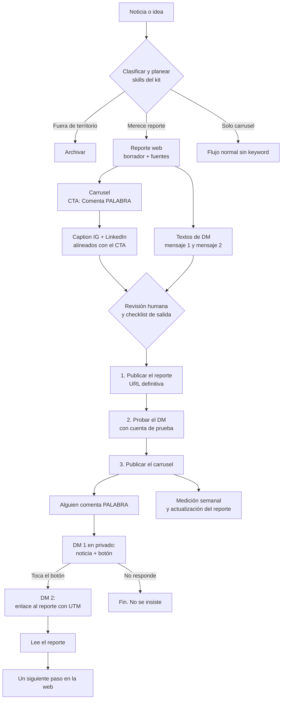

# Flujo CTA con reporte: de la noticia al reporte de Plogy por DM

Estado: METODOLOGÍA Y FLUJO REGISTRADOS. Nada de esto está construido ni configurado, y no se modifica el resto del kit hasta que Luciano lo pida. Fecha: 2026-10-19. Decisiones de Luciano del mismo día registradas en la sección 13.

Idea de Luciano: en las piezas de noticias, el CTA invita a comentar una palabra (por ejemplo, BANCO). Quien comenta recibe por DM la noticia completa y después el enlace a un reporte de Plogy, en la web de Plogy, con la misma noticia explicada más a fondo y desde el ángulo de Plogy.

Este documento convierte esa idea en un flujo que otras sesiones de Claude y otros agentes puedan seguir. Complementa `SKILL.md` y `METODOLOGIA.md` (variante D, "recurso por DM").

## 1. Resumen en 6 líneas

1. Cada noticia relevante produce tres piezas que se preparan juntas: carrusel, reporte web y mensajes de DM.
2. El reporte se publica **antes** que el carrusel. La regla del kit ya lo exige: un CTA de recurso por DM requiere que el recurso y su entrega estén preparados.
3. El CTA del último slide usa una palabra clave propia de cada pieza: "Comenta BANCO".
4. El DM va en dos pasos porque Meta lo obliga y porque además funciona mejor: mensaje 1 con la noticia y un botón; mensaje 2, tras el botón, con el enlace al reporte.
5. Cada enlace lleva UTM para saber qué pieza trajo qué lectura.
6. Todo pasa por revisión humana: texto del carrusel, texto del reporte y textos del DM.

## 2. Diagrama



## 3. Las tres piezas de una oportunidad

| Pieza | Para qué sirve | Profundidad | Dónde vive |
| --- | --- | --- | --- |
| Carrusel | Captar atención, dar el hecho y el criterio, llevar al CTA | Una idea por lámina, 6 a 8 láminas | Instagram, con adaptación a LinkedIn |
| Mensajes de DM | Entregar lo prometido y llevar al reporte | Dos mensajes cortos | Instagram DM |
| Reporte web | Explicar a fondo: hechos con fuente, lectura de Plogy, qué significa para un negocio, qué no se sabe | Un artículo de lectura de varios minutos | Web de Plogy |

Regla para no repetir: el carrusel da el gancho y el criterio, el DM entrega, el reporte profundiza. No copies el texto del carrusel dentro del reporte ni el del reporte dentro del carrusel.

## 4. Cuándo una noticia lleva reporte

No todas. Reporte solo si cumple lo siguiente:

- Pasó el clasificador: dentro del territorio de Plogy, pilar claro, confianza media o alta.
- Hay un ángulo propio de Plogy que no cabe en 7 láminas (un marco, una comparación, una consecuencia para negocios).
- Hay fuentes suficientes para sostenerlo y se puede decir qué no se sabe.
- Alguien del equipo puede revisarlo antes de publicar.

Si no cumple, el carrusel va con CTA de seguimiento o de comunidad (variantes A, B, C o F de `METODOLOGIA.md`) y no necesita keyword.

## 5. El CTA en el carrusel

- Forma: "Comenta **PALABRA**" más una línea que diga qué recibe la persona.
- Copy base: "Comenta BANCO y te mandamos la noticia completa y nuestro análisis."
- Diseño: tarjeta de vidrio de `METODOLOGIA.md`, sección 4, o el botón naranja de la variante D.
- Una sola acción. La palabra y la promesa deben coincidir exactamente con lo que el DM entrega.
- El caption de Instagram y el post de LinkedIn cierran con la misma acción. En LinkedIn no hay DM por comentario: ahí el cierre invita a leer el reporte con el enlace directo, con los mismos UTM de LinkedIn.

### Reglas de la palabra clave

- Una palabra por pieza, corta, sin tildes ni signos (BANCO, no "Bancos" ni "Cuéntame").
- Que tenga relación visible con la noticia, para que no se confunda con otras piezas.
- Que no colisione con otra pieza activa. Se lleva un registro (sección 11).
- La automatización debe aceptar mayúsculas, minúsculas y espacios de más. Decidir antes si acepta variantes con tilde.
- Cada palabra tiene una ventana de vigencia (propuesta: 30 días) y un mensaje de cierre para quien comenta después.

## 6. El flujo de DM (dos mensajes)

### Por qué dos mensajes

Según la documentación de Meta (Instagram Messaging API, "Private Replies"), un comentario permite **un solo mensaje privado** y solo dentro de los 7 días posteriores al comentario. Para seguir la conversación, la persona debe responder y entonces se abre una ventana de 24 horas. Por eso la secuencia es:

1. **Mensaje 1 (respuesta privada al comentario, inmediata):** entrega la noticia y ofrece el análisis con un botón.
2. **Mensaje 2 (tras tocar el botón):** el enlace al reporte de Plogy.

Esto además filtra: quien toca el botón quiere el análisis.

### Textos propuestos (ejemplo con la pieza 002)

Mensaje 1:

> Gracias por comentar BANCO. Aquí está la noticia completa: [enlace a la fuente original]. En una línea: Schwab y JPMorgan no dejan que agentes de IA externos muevan el dinero de sus clientes. ¿Quieres nuestro análisis de lo que significa para tu negocio?
> [Botón: Sí, mándamelo]

Mensaje 2:

> Este es el reporte de Plogy: [enlace con UTM]. Incluye lo que pasó con sus fuentes, la escalera de cuatro niveles de permiso para un agente y lo que todavía no sabemos.

Reglas de redacción del DM:

- Voz Plogy: directa, sin humo, sin muletillas de IA, sin guiones largos, sin promesas de resultado.
- Que diga solo lo que el reporte contiene. Si el reporte no trae una lista, el DM no promete una lista.
- Sin emojis por defecto.
- Un solo enlace por mensaje.
- No se insiste a quien no responde. No hay recordatorios automáticos fuera de lo que permita la plataforma.

### "Noticia completa" significa enlace, no copia

El mensaje 1 entrega el **enlace a la fuente original** y una línea de resumen propia. No se republica el texto íntegro del artículo de otro medio: es propiedad de ese medio.

## 7. El reporte en la web de Plogy

### Estructura

Un artículo por noticia, en una URL estable (propuesta: `/reportes/<slug>`).

| # | Sección | Contenido |
| --- | --- | --- |
| 1 | Titular y fecha | Titular claro, fecha de publicación y fecha de actualización |
| 2 | Resumen | Tres líneas con lo esencial |
| 3 | Qué pasó | Los hechos, cada uno con su fuente |
| 4 | Qué se sabe y qué no | Separar hecho, interpretación e hipótesis. Marcar lo no verificado |
| 5 | La lectura de Plogy | La tesis propia, con el ángulo que no tiene el resto de la prensa |
| 6 | Qué significa para tu negocio | El criterio o marco aplicable. Ejemplos hipotéticos rotulados como tales |
| 7 | Qué haría Plogy primero | Pasos concretos y verificables, sin promesas de resultado |
| 8 | Fuentes | Enlaces, fecha de consulta y qué se leyó directamente |
| 9 | Siguiente paso | Una sola acción: seguir a Plogy, o la que Plogy defina |
| 10 | Historial de cambios | Qué se actualizó y cuándo |

Metadatos internos (no visibles o en el pie): id de pieza, estado (borrador, revisado, publicado), pilar, audiencia, palabra clave, carrusel asociado, autor y revisor.

### Reglas

- Los hechos se atribuyen a su fuente. Las hipótesis se marcan como hipótesis. Documental exige material real.
- Si la noticia cambia, se actualiza el reporte y se anota en el historial. El enlace del DM no cambia.
- Una persona del equipo lo revisa antes de publicar. Debe quedar anotado quién y cuándo.
- Optimización para búsqueda: título con el término principal, descripción breve, datos estructurados de artículo. Tratar el reporte como contenido que también debe encontrarse en buscadores, no solo desde el DM.

## 8. Medición

No hay cifras de referencia: se mide y se compara pieza contra pieza.

| Qué | Dónde se mide |
| --- | --- |
| Comentarios con la palabra clave | Instagram o la herramienta de DM |
| Mensajes 1 entregados | Herramienta de DM |
| Toques en el botón | Herramienta de DM |
| Clics al reporte | UTM en la analítica de la web |
| Lecturas del reporte y tiempo en página | Analítica de la web |
| Siguientes pasos hechos en la web | Analítica de la web |
| Nuevos seguidores en la semana de la pieza | Instagram |

UTM propuestos: `utm_source=instagram` (o `linkedin`), `utm_medium=dm` (o `post`), `utm_campaign=<id de pieza>`, por ejemplo `002-bancos`.

Revisión: una vez por semana, comparar las piezas con reporte contra las de seguimiento y comunidad. Decidir con datos si el flujo merece el trabajo extra.

## 9. Pipeline para agentes (orden de trabajo)

Se añaden pasos al flujo del kit. Todo lo demás sigue igual (`AGENTS.md`).

1. Clasificar (skill `plogy-content-classifier`).
2. Planear (`plogy-content-planning`) y **decidir si lleva reporte** (sección 4). Elegir la palabra clave y revisar el registro.
3. **Redactar el reporte** en `reporte.md` dentro de la carpeta de la pieza, con la estructura de la sección 7 y las fuentes.
4. Escribir las láminas (`plogy-narrative-language`), con CTA "Comenta PALABRA".
5. Adaptación visual y diseño del CTA (`plogy-visual-adaptation`, `plogy-cta-design`).
6. Captions de Instagram y LinkedIn (`plogy-captions`), alineados con el CTA.
7. **Redactar los DM** en `dm.md`: mensaje 1, botón, mensaje 2 y mensaje de cierre de campaña.
8. Revisión y checklist de salida (sección 10).
9. Entrega a revisión humana. Los agentes no publican en redes ni en la web.

Estructura de carpeta de una pieza con reporte:

```
piezas/<id>-<slug>/
  brief.md           brief y clasificación (con campos nuevos, ver 12)
  carrusel.html      diseño editable
  exports/           PNG de las láminas
  reporte.md         borrador del reporte web
  dm.md              mensajes 1, 2 y de cierre
  assets/            derivados de foto
```

## 10. Checklist de salida (puerta antes de publicar el carrusel)

- [ ] Reporte revisado por una persona y publicado en su URL definitiva.
- [ ] Cada hecho del reporte tiene fuente. Hipótesis marcadas. Lo no verificado, anotado.
- [ ] Palabra clave registrada, sin colisión con otra pieza activa, con fecha de vigencia.
- [ ] Mensajes de DM aprobados por una persona.
- [ ] Flujo probado de punta a punta con una cuenta de prueba: comentario, mensaje 1, botón, mensaje 2, enlace correcto con UTM.
- [ ] Qué ocurre si la herramienta falla: alguien responde a mano y sabe quién es.
- [ ] Alguien revisa los DM entrantes los primeros días.
- [ ] Mensaje de cierre configurado para cuando venza la ventana.
- [ ] CTA del carrusel, caption de Instagram y LinkedIn dicen lo mismo y prometen solo lo que el reporte tiene.
- [ ] Derechos de fotos y licencias de tipografía resueltos (hoy siguen pendientes).
- [ ] Aprobación humana con fecha.

## 11. Registro de palabras clave

Se mantiene en `skills/plogy-cta-design/registro-palabras-clave.md` (por crear al aprobar el flujo).

| Palabra | Pieza | Reporte | Vigencia | Estado |
| --- | --- | --- | --- | --- |
| BANCO | 002 Los bancos frenan a los agentes de IA | por crear | por definir | propuesta |

## 12. Cambios que traería en el kit (a aprobar)

1. Añadir al brief (`templates/opportunity-and-carousel-brief.md`) un bloque "Reporte y DM": ¿lleva reporte?, palabra clave, URL del reporte, estado del reporte, estado del DM, ventana de vigencia.
2. Añadir `reporte.md` y `dm.md` como entregables opcionales de `plogy-carousel-production`.
3. Crear una skill `plogy-news-report` para redactar reportes con su estructura y reglas.
4. Crear el registro de palabras clave.
5. Actualizar `AGENTS.md` con el orden de trabajo de la sección 9.

Hasta que se apruebe, nada de esto se modifica.

## 13. Decisiones de Luciano y cosas que siguen abiertas

Registradas el 2026-10-19. Luciano pidió solo documentar: no se construye ni se configura nada todavía.

| # | Tema | Decisión | Pendiente |
| --- | --- | --- | --- |
| 1 | Web de Plogy y publicación de reportes | Se configura más adelante. No hace falta resolverlo ahora. | Definir dónde vive el reporte y cómo se publica un artículo. La propuesta sigue siendo `/reportes/<slug>`. |
| 2 | Herramienta de DM | Luciano piensa en **ManyChat**. Preguntó por alternativas. | Ver la sección 16, con criterios y candidatas. No se ha elegido ni contratado nada. |
| 3 | Quién se encarga del reporte y de los DM | Hay que crear un **agente encargado** de esto. | Ver la sección 17. Falta confirmar si "agente" es un agente de IA, una persona o ambos. Se registró como agente de IA con una persona responsable de aprobar. |
| 4 | Correo y teléfono | Sí se pedirán, **en el futuro**. | Ver la sección 18. No se activa nada ahora. |
| 5 | Quién responde los mensajes que lleguen por fuera del flujo | Sin definir. | Asignar una persona y un horario antes de activar el flujo. |
| 6 | Siguiente paso del reporte en la web | Sin definir. | Propuesta: seguir a Plogy. |
| 7 | Vigencia de una palabra clave | Sin definir. | Propuesta: 30 días. |

## 14. Riesgos y qué hacer con ellos

| Riesgo | Mitigación |
| --- | --- |
| Reglas de Meta distintas a las que apliqué | Verificar en la documentación oficial de Meta antes de configurar. Los blogs de terceros se contradicen en límites por hora y por usuario. Tomar solo la regla del mensaje privado por comentario y la ventana de 24 horas, que la documentación de Meta describe de forma consistente |
| Enlaces dentro de un DM automático | No encontré una fuente que lo trate de forma específica. Probar con la cuenta de prueba. Plan B: el mensaje 1 solo con resumen y botón, y todos los enlaces en el mensaje 2 |
| Cuenta restringida por exceso de mensajes | Ritmo moderado, sin recordatorios masivos, herramienta con API oficial |
| Promesa que el reporte no cumple | Redactar el CTA y el DM desde el reporte ya terminado, no al revés |
| Datos personales | Si se pide correo, hace falta consentimiento y política de privacidad. Si Plogy opera en Colombia, aplica la Ley 1581 de 2012. Confirmarlo con asesoría legal |
| Propiedad de la noticia | Enlazar la fuente, no copiar el artículo |
| Reporte desactualizado | Fecha de actualización visible e historial de cambios |

## 15. Ejemplo aplicado: pieza 002

La pieza 002 hoy usa "Comenta Plogy" (comunidad). Si se adopta este flujo, cambiaría así:

- Palabra: BANCO.
- Lámina 07: "Comenta BANCO y te mandamos la noticia completa y nuestro análisis."
- Caption de Instagram: cerrar con la misma acción.
- Reporte `/reportes/bancos-frenan-agentes-ia`: la escalera de cuatro niveles como eje, hechos de The Next Web y Bloomberg con fuente, "lo que no sabemos" (los conteos de bloqueo que da el CEO de Schwab, si se permite operar en bolsa, la cita de Dimon por fuente secundaria), checklist de permisos para un negocio.
- DM: los dos mensajes de la sección 6.
- Antes de publicar: cumplir la sección 10.

Nada de esto se aplica a la pieza 002 sin aprobación.

## 16. Herramienta de DM: ManyChat y alternativas

Estado: sin elegir ni contratar. Luciano pensaba en ManyChat y pidió alternativas.

### Aviso sobre las fuentes

Casi todo lo publicado sobre este tema son blogs de los propios proveedores, que se colocan primeros en sus rankings. Tampoco hay precios vigentes confiables, porque cambian y los blogs se contradicen. Esta sección da candidatas y criterios, **no un ranking ni precios**. Antes de decidir, revisar la página de precios y la ficha de cada herramienta, y confirmar su estado con Meta (partner oficial, uso de la API oficial).

### Qué es común a todas

- Las que usan la API oficial de mensajería de Instagram siguen las reglas de Meta descritas en la sección 6: un mensaje privado por comentario dentro de 7 días, y la conversación continúa solo si la persona responde o toca un botón (ventana de 24 horas).
- Un bot que funcione con contraseña o sesión simulada, y no con la API oficial, pone la cuenta en riesgo. Se descarta.
- Incluso con integración oficial, una cuenta puede ser restringida por exceso de mensajes automáticos o respuestas públicas repetitivas. Es un riesgo de cualquier herramienta, ManyChat incluida.

### ManyChat (la opción pensada)

- Comentario con palabra clave como disparador y respuesta privada, según las descripciones consultadas.
- Es una plataforma amplia (Instagram, Messenger, WhatsApp), y por eso a veces es más de lo que hace falta.
- Dudas a verificar: idioma de la interfaz y el soporte para un equipo en español, cómo se cobra (por contactos o por funciones), y los costes de añadir IA.

### Alternativas mencionadas en las fuentes

| Herramienta | Enfoque según las fuentes | Para tener en cuenta |
| --- | --- | --- |
| LinkDM | Solo comentario a DM en Instagram, la más simple | Sencilla, pero con menos funciones para crecer a correo y WhatsApp |
| InstantDM | Solo Instagram, precio plano, se presenta como partner oficial de Meta | Verificar el estatus de partner en el listado de Meta |
| Komently | Comentario a DM en Instagram y Facebook, precio plano | Hay plan gratuito con límite de mensajes |
| Waveloop | Solo Instagram | La fuente que la ubica primera es del propio proveedor |
| Chatfuel | Instagram, Facebook y WhatsApp | Alternativa comparable a ManyChat en canales |
| Wati | Centrada en WhatsApp, con Instagram en la misma bandeja | Tiene sentido si WhatsApp va a ser el canal principal |
| Inrō | Orientada a agentes de IA | Plan gratuito con pocos contactos |
| Reach Tools | Enfocada en América Latina, soporte en español | Hay que revisar su comparativa y su estatus |
| mLabs Chat (Brasil) | Gestiona Instagram, Facebook, WhatsApp y Google en una bandeja | Producto de origen brasileño. Verificar idioma y soporte |
| EZContact | Orientada a WhatsApp con agente de IA, para México, Colombia y Argentina | Se centra más en atención al cliente que en comentario a DM |

No encontré información útil sobre Botmaker ni Kommo: no se pueden valorar con esta búsqueda.

### Criterios para elegir (ordenados por importancia para Plogy)

1. **API oficial de Meta y estatus de partner verificable.** Sin esto no se considera.
2. **Disparador por palabra clave en comentarios**, con respuesta privada, botón y secuencia de dos mensajes.
3. **Enlaces dentro de los mensajes.** No hay fuente fiable sobre qué se permite. Se prueba con una cuenta de prueba.
4. **Etiquetas y exportación de contactos**, para poder crecer hacia correo y teléfono (sección 18) y para llevar el registro de quién pidió qué.
5. **Bandeja compartida con traspaso a una persona** cuando alguien escribe fuera del flujo.
6. **Canal de WhatsApp** disponible si llega el momento de usar el teléfono.
7. **Soporte y panel en español.**
8. **Estadísticas y UTM.** Que se pueda medir el clic al reporte (sección 8).
9. **API o webhooks**, para que en el futuro el agente de reportes y DM pueda leer el registro de la herramienta.
10. **Modelo de precios.** Por contactos o plano, y qué pasa al crecer.
11. **Propiedad de los datos.** Dónde se guardan los contactos y cómo se exportan o borran.

### Cómo decidir sin invertir de más

1. Preseleccionar ManyChat más una o dos alternativas con la lista anterior.
2. Probar cada una con una cuenta de prueba de Instagram y un flujo mínimo: comentario, mensaje 1 con botón, mensaje 2 con enlace.
3. Anotar qué se comporta distinto: enlaces, tiempos, etiquetas, exportación.
4. Elegir con esa prueba y con la lectura de las condiciones de Meta, no con un ranking de blog.

## 17. Agente encargado del reporte y de los DM

Estado: especificación registrada. No existe todavía. Luciano pidió que se cree un agente encargado de esta parte.

### Interpretación

Se interpreta como un agente de IA especializado, con una persona humana que aprueba. Si la intención era otra (por ejemplo, una persona dedicada), ajustar esta sección.

### Nombre provisional

Agente de reportes y DM.

### Qué hace

- Convierte una oportunidad aprobada en `reporte.md`, con la estructura de la sección 7 y las fuentes, aplicando las reglas del kit: no inventa datos, marca hipótesis, distingue hecho de interpretación, escribe en español con voz Plogy, sin guiones largos ni muletillas de IA.
- Redacta `dm.md`: mensaje 1, botón, mensaje 2 y mensaje de cierre de campaña, alineados con el reporte ya terminado.
- Mantiene el registro de palabras clave (sección 11).
- Revisa que el CTA del carrusel, el caption, el LinkedIn y el DM prometan lo mismo que el reporte.
- Prepara el checklist de salida (sección 10) con el estado de cada punto.
- Sugiere actualizaciones del reporte cuando la noticia cambia y las deja como borrador.

### Qué no hace

- No publica el reporte, no publica en redes y no envía DM. Todo pasa por una persona.
- No configura la herramienta de DM ni cambia sus flujos sin aprobación.
- No pide ni guarda correos o teléfonos mientras no esté resuelta la sección 18.
- No promete en un DM algo que el reporte no tenga.

### Entradas y salidas

| Entrada | Salida |
| --- | --- |
| Brief con clasificación, tesis, fuentes y objetivo de la pieza | `reporte.md`, `dm.md`, estado de palabra clave y checklist |
| Carrusel y caption terminados | Informe de coherencia entre CTA, caption, LinkedIn, reporte y DM |
| Noticias de seguimiento o correcciones | Propuesta de actualización del reporte |

### Persona responsable

Una persona del equipo aprueba el reporte, aprueba los DM, publica y responde lo que llegue por fuera del flujo. Falta definir quién. Hasta que exista, el flujo no se activa.

### Fases propuestas

1. **Fase 1, redactor asistido.** El agente redacta reporte y DM, la persona aprueba y publica. Es el alcance de esta documentación.
2. **Fase 2, apoyo en respuestas.** El agente propone borradores de respuesta a los mensajes libres que lleguen por DM y la persona los aprueba antes de enviarlos.
3. **Fase 3, automatización limitada.** Respuestas automáticas solo a preguntas frecuentes ya validadas y dentro de límites escritos. Solo si las fases anteriores demuestran que es seguro.

### Dónde se anota en el kit cuando se construya

Cuando se apruebe construirlo: una skill propia (por ejemplo `plogy-news-report`) con estas reglas, y su lugar en el orden de trabajo de la sección 9. Hasta entonces, queda solo como especificación.

## 18. Captura futura de correo y teléfono

Estado: decisión de futuro de Luciano. No se activa ahora.

### Principios

1. **Primero valor, después la petición.** El reporte es de lectura libre. El correo y el teléfono se piden después, nunca como condición para leer.
2. **Opcional y explícito.** La persona decide. Una casilla de consentimiento sin marcar de antemano, con una frase clara de para qué se usa el dato.
3. **Un dato a la vez.** Correo primero. Teléfono solo si se va a usar de verdad (por ejemplo, para WhatsApp) y con consentimiento propio.
4. **Mínimo necesario.** Se pide lo que se va a usar.
5. **Se puede salir.** Forma sencilla de darse de baja y de pedir que se borren sus datos.
6. **Aviso de privacidad.** Debe existir y enlazarse en el punto donde se pide.
7. **Dónde se guarda.** En una base de datos con responsable, no en la bandeja de un chat. Definir antes dónde.

### Dónde podría ir en el flujo

- En la web, al final del reporte, con un formulario opcional.
- En el DM, después del mensaje 2, como un tercer paso opcional si la herramienta lo permite.

La opción de la web tiende a respetar mejor el orden "primero valor". Decidir cuando se configure.

### Cosas que condicionan la elección de la herramienta de DM

Etiquetas, exportación de contactos y, si el teléfono se va a usar para WhatsApp, un canal de WhatsApp en la misma plataforma o una integración clara. Ver los criterios 4 y 6 de la sección 16.

### Antes de activarlo

- [ ] Aviso de privacidad redactado.
- [ ] Revisión legal sobre datos personales. Si Plogy opera en Colombia, aplicaría la Ley 1581 de 2012. Confirmarlo con asesoría legal.
- [ ] Persona responsable de los datos definida.
- [ ] Base de datos o CRM elegidos.
- [ ] Consentimiento y baja probados de punta a punta.
- [ ] Reglas de WhatsApp para el teléfono verificadas con Meta antes de enviar mensajes.

## 19. Fuentes consultadas en esta sesión

Para la mensajería de Instagram (sección 6):

- Meta, "Private Replies" de la API de mensajería de Instagram (documentación oficial, aparece en los resultados de búsqueda y se resume aquí; confirmar directamente en developers.facebook.com).
- Varias guías de terceros sobre automatización de comentarios a DM, que difieren en límites por hora y por usuario. No se usan sus cifras.

Para las herramientas (sección 16): blogs de proveedores comparando alternativas a ManyChat. Todos tienen interés comercial. No se usan sus precios ni sus rankings.

Para la noticia usada como ejemplo: ver el brief de la pieza 002.

## 20. Primera aplicación: pieza 003

2026-10-19. Luciano pidió generar el reporte en la pieza 003, así que esta pieza es la primera que aplica el flujo. Archivos en `piezas/003-costo-por-token-vs-por-tarea/`: `reporte.md` y `reporte.html` (el reporte), `dm.md` (mensajes 1, 2 y de cierre, con UTM), `textos.md` (caption de Instagram y LinkedIn), `brief.md` (con el checklist de salida y su estado) y `carrusel.html` con el CTA "Comenta COSTO".

Todo está en borrador. Siguen pendientes la herramienta de DM, la web, la persona responsable y el resto de decisiones de la sección 13. Lo que se aprendió al aplicarlo:

- Redactar el reporte primero ayudó a escribir el DM y el CTA sin prometer de más: el mensaje 2 solo menciona secciones que existen en el reporte.
- El reporte necesita una sección clara de "qué se sabe y qué no", porque las fuentes de noticias tecnológicas se contradicen en fechas y disponibilidad.
- Hay que anotar el interés comercial de cada fuente (en la pieza 003, la fuente principal vende acceso al modelo del que habla).
- Para ver una pieza completa (láminas, reporte, textos y DM) se creó el visor `piezas/visor.html`. Las páginas `.html` de los textos se generan desde los `.md` con `piezas/_visor/md_to_html.py`.

## 21. Regla: los reportes llevan imágenes (decisión de Luciano, 2026-10-19)

Todo reporte de Plogy se entrega con imágenes, no solo texto. Cómo se aplicó en la pieza 003 y cómo repetirlo:

- **Mínimo por reporte:** una portada, una figura por cada cifra o idea central (precios, comparación, fórmula, ejemplo) y, si encaja, una foto de la biblioteca con pie de figura.
- **Las figuras se hacen en HTML y se exportan a PNG** (1600x900) con `scripts/render-slides.ps1 -Width 1600 -Height 900 -Param f`. En la pieza 003 viven en `reporte-figuras.html` y se exportan a `assets/reporte/fig-*.png`.
- **Cada figura usa solo cifras del reporte** y dice su fuente dentro de la imagen. Lo que es cálculo de Plogy se rotula como tal (en 003, la barra rayada de GPT-6 Astra) y lo hipotético lleva la etiqueta "Ejemplo hipotético". No se dibujan datos que la fuente no tenga.
- **En el .md** se insertan con `` en su propia línea. El texto alternativo describe la cifra, no solo la imagen. `piezas/_visor/md_to_html.py` las convierte en `<figure>` con pie.
- **Fotos de la biblioteca:** siguen siendo `unverified_reference_only`, así que el pie de figura avisa que los derechos están por verificar.
- **Revisión:** mirar cada PNG a ojo (en 003 la portada tuvo el texto encima del subtítulo y hubo que corregirlo) y renderizar la página del reporte completa antes de darla por buena.
- **Checklist de salida (sección 10):** añadir "el reporte tiene portada y figuras revisadas, con fuente visible en cada una".

## 22. Segunda aplicación: pieza 004 (2026-10-19)

`piezas/004-gpt-4o-se-apaga-14-enero/`: noticia de OpenAI (GPT-4o y GPT-4.1 salen de la API el 14 de enero de 2027). Palabra clave MIGRAR, CTA variante D (recurso). Lo aprendido:

- **Fuente primaria primero.** Aquí sí se leyeron las páginas de OpenAI (deprecaciones, ficha del modelo, guía de razonamiento). Los hechos centrales quedaron "confirmados en OpenAI" y lo demás se rotuló como de terceros. El mensaje 1 del DM enlaza a la página de OpenAI, no a un blog.
- **Las figuras llevan la procedencia dentro.** Lo que viene de un tercero o no está confirmado se marca en la propia imagen (en 004, el punto discontinuo del 6 de enero y la columna de GPT-4o).
- **Evitar mayúsculas forzadas en nombres de modelo.** `text-transform:uppercase` convirtió "GPT-4o" en "GPT-40"; en esas etiquetas se quitó.
- **El reporte puede ser el recurso.** La lista de revisión de seis comprobaciones va como figura y como lista con casillas dentro del reporte, y el DM la promete.
- **No citar piezas internas en un reporte público** (decía "la pieza 003"): se reescribe como idea suelta.
- Ya hay cuatro piezas en el visor (`piezas/visor.html`).

## 23. Variante educativa: pieza 005 (2026-10-20)

`piezas/005-medir-antes-de-automatizar/`: primera pieza que no parte de una noticia. El recurso es una guía con plantilla y la palabra clave es MEDIR. Diferencias con el flujo de noticias:

- **Sin fuente externa.** El brief lo declara: tipo de origen "criterio propio de Plogy". No se citan cifras de terceros; las del ejemplo son inventadas y se rotulan como hipotéticas en láminas, figuras y textos.
- **Mensaje 1 del DM sin enlace de noticia.** Resume lo que contiene la guía y trae el botón. Solo el mensaje 2 lleva enlace (con UTM).
- **La guía es el recurso.** Incluye una plantilla copiable (tabla y figura) y una lista de comprobación final.
- **Lo que debe quedar escrito:** lo que la guía no cubre (muestra estadística, beneficios no medibles en tiempo, costo de construir la automatización).
- Ya hay cinco piezas en el visor.
